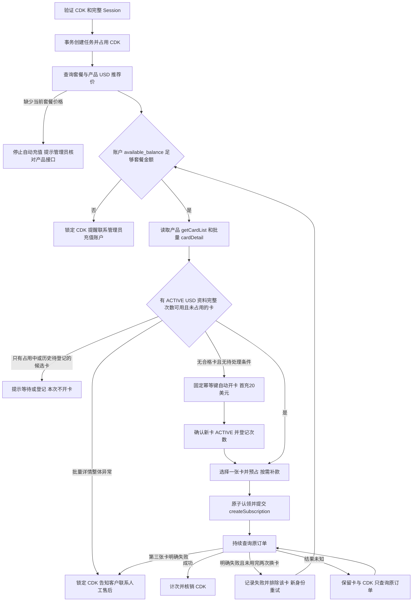

# Orbitcard 选卡、自动补款与申请卡

## 卡片读取与后台快照

- `POST /api/open/v1/getCardList` 用于分页列出卡 ID；`POST /api/open/v1/cardDetail` 使用 `card_id` 查询单卡，或 `card_ids` 批量查询最多 20 张，始终发送 `reveal_sensitive: false`。
- 2026-10-21 实测批量响应为 `data: {total, succeeded, failed, items: [{index, card_id, success, data}]}`。必须展开每项 `data`，再检查内外卡 ID、重复 ID、逐项 `success` 和卡状态；不能把外层 `code=0` 当作每张卡详情成功。也兼容数组、`list`、`cards` 扁平结果。
- 平台脱敏卡号字段为 `card_number_masked`，只保留最后四位。储值卡 `card_type=save` 的 `available_amount` 按当前 V1 美元余额约定处理，缺少 `currency` 时补齐 USD；平台显式返回的其他币种不会被覆盖，其他缺失币种的数据仍不可用于支付。
- 后台“刷新本地记录”只查询数据库，明确标注“本地快照”；“同步平台卡片”先读平台列表和详情，再更新可确认的卡片。逐项失败的卡显示“详情读取失败 / 旧快照”，同步整体失败显示失败提示；平台本次未返回的历史卡也不会被标为本次同步成功。
- `ACTIVE` 对应平台“正常”，`CANCELLED` 对应“冻结”。平台余额同步不会自动推断会员成功次数，也不会修改已登记次数或正在占用的任务。
- 运行日志新增 `card_response` 结构摘要（容器类型、返回项数、包装项数、失败项数）及 `cards_sync_failed`，不写入原始卡详情、卡号、CVV 或账单地址。付款选卡使用本次平台详情，不能回退到旧快照的状态或余额。

## 规则

- Plus 一张平台卡最多成功充值 4 次。
- Pro 100、Pro 200、Pro 500 各自最多成功充值 1 次，互不占用对方额度。
- 同一卡可混用四种套餐，合计最多 7 次（4+1+1+1）。某套餐已满不影响其他套餐；历史次数确认后可由管理员核对修正，但不能提高套餐上限。历史 `pro_5x` 对应 Pro 100，`pro_20x` 对应 Pro 200。
- 每张卡同一时间只处理一笔充值。预占不是成功；等待上游、验证、超时和未知结果保持占用。明确失败或确认提交被拒绝后释放本次预占，不增加成功次数。
- 成功次数和占用持久化在 MySQL，刷新、重启或同步列表均不清零。卡片计次、任务结果和 CDK 结算在同一事务提交；重复成功响应不会重复计次。

## 充值选卡与支付换卡

先调用 `getAccountBalance` 读取 `available_balance`，再从 `getProductCode` 取得当前套餐的 USD 价格并检查账户余额；产品缺价时停止自动充值，余额不足时锁定 CDK 并提示联系管理员手动充值。付款时读取 `getCardList` 和批量 `cardDetail(card_ids)`，每批最多 20 张；仅从本轮批量结果中选择状态 `ACTIVE`、USD、余额资料有效、已确认历史次数、当前套餐次数未满且未被任务占用的卡。批量详情缺少个别卡时跳过缺项并选其余合格卡，不逐张补查。优先用合格旧卡；余额不足时补差额，没有合格卡时自动开卡。列表有卡但整批详情都缺失、批量返回外来或重复卡 ID 时停止选卡并锁定 CDK；平台网络或认证故障也不能被当作空库存。

合格卡按所需补款差额排序，预占一张；余额不足时调用 `rechargeCard` 补到「套餐金额 + 产品最低保留余额」。补款提交前及补款确认后仍按原补款意图核对卡片状态和余额，避免重复资金操作。选卡完成后不再额外逐张复核候选卡，也不在 `createSubscription` 前再次调用单卡详情。订阅已提交或结果未知时，只核对原订单，绝不因为超时换卡重付。

`orbitcard-payment-decision.js` 对同一批平台快照给出四种决策，`orbitcard-card-service.js` 执行并持久化：

| 决策 | 条件 | 后续动作 |
| --- | --- | --- |
| `pay` | 合格卡余额已达到产品套餐价格加最低留存额 | 原子预占后提交订阅 |
| `fund` | 合格卡仍有次数但余额不足 | 持久化差额补款意图，确认补款与余额后提交 |
| `wait` | 没有合格卡可立即选择，但还有占用中或历史未确认的候选卡 | 提示等待或登记；本次不花钱开新卡 |
| `open` | 没有合格卡，也没有上述待处理条件 | 符合产品及账户资金条件后首充 20 USD 开卡 |

优先恢复本任务原补款或原开卡，而不是先选择另一张新出现的卡。已开好的原卡使用同一任务继续准备，不再重复套用开卡前的账户余额门槛；如还需补款，仍实时检查该差额的可用余额。原资金操作失败、归属不一致或结果未知时停止当前任务，不创建替代资金请求。批量详情全部失败、归属异常和网络错误属于查询失败，不能产生 `open` 决策。

`card_payment_decision` 审计记录决策、候选数量、等待卡 ID 与原因、排除数量；`card_unavailable` 记录排除原因。单卡状态、余额以本轮详情为准，只有产品码、BIN 和尾号可用本轮列表补齐。

只有尚未转人工、平台订阅详情明确确认失败且订单归属一致时，才释放失败卡的预占并创建新订单。下一次重新读取平台列表与批量详情，排除已失败卡，最多换两次，即三张不同卡各支付一次。若没有其他可用的旧卡，可按同一规则自动开新卡；整批详情异常时转人工售后。第三张卡也明确失败则锁定 CDK。每笔失败订单及卡片 ID 保留审计记录；尚未转人工的重试需要原目标账号的新 Session。成功次数仅在订阅成功时增加。

一旦转人工处理，自动支付立即退出，不再开卡、补款、换卡重试或创建订阅。开卡与补款恢复必须取得原订单执行锁，并在每次资金请求前重新检查订单；人工状态或人工核销会阻止这些请求。未确认资金记录保持原样供售后核对，后台不会重发；已提交的原订阅可以只读查单，失败后仍保留 CDK 售后锁定，成功则结算原单。人工状态不会因查到 `pending` 而改回自动处理，重复提交原请求也不能恢复付款。

## 卡片预算、补款与自动开卡

套餐金额只取产品目录中对应的 USD 价格；目录未提供时停止自动充值，旧后台预算和订阅套餐的 USDT 服务费都不能替代套餐金额。`rechargeCard` 的金额为 `max(0, 套餐金额 + 最低保留余额 - 卡片可用余额)`，用定点十进制向上取整到美分。补款意图、原订单号、请求正文、幂等键及 API Key 身份在发送前持久化；结果未知时只确认原补款，不重复扣款，也不切换卡。

自动或管理员手动申请卡时，实时调用 `getProductCode` 选择符合库存及最低首充要求的产品，向 `createCard` 仅发送 `product_code`、`amount:"20.00"`、`quantity:1`。自动申请先把原请求正文、产品、金额、API Key 身份及固定幂等键落库并绑定 CDK；结果未知时只确认原申请，不换键重复开卡。新卡确认 `ACTIVE` 后登记独立套餐次数，余额不足则按原补款规则补差额，再提交订阅。单卡首充上限只约束首次开卡充值；后台可设置开卡产品码，但不设置套餐支付价格。

Plus 每卡最多成功 4 次；Pro 100、Pro 200、Pro 500 各最多成功 1 次，四项独立计数且可混用。历史卡需管理员确认已有次数后参与选卡。同步平台卡片不会重置计数或卡片占用。

## 管理后台与已有卡迁移

「卡片与开卡」提供：同步平台卡片、查看状态/尾号/余额、四项成功次数与占用、查询产品、库存和开卡参数、手动申请首充 20 USD 的卡，以及确认原开卡/补款。「Orbitcard 配置」保留四档默认地区设置；接口调试提供连接、套餐余额、地区与实时选卡预检，并提供真实测试及持久化日志。推荐价展示已删除，后台资金校验依据保留。补款记录显示任务、卡 ID、原订单、金额、费用和目标余额。CDK 列表标识账户余额不足锁定。

历史卡片的订阅使用次数不能从卡片列表可靠推断，因此同步后保持“历史未确认”。管理员通过二级验证，如实分别填写 Plus、Pro 100、Pro 200、Pro 500 的历史成功次数，卡片才参与自动选卡。不要把已使用的卡当成全新卡填写 0。尚有旧版本未绑定卡片身份的未确认充值时，先查清原订单，再确认历史次数。

原固定 `orbitcard_card_id` 配置保留为历史兼容数据，不再作为充值卡源，不会自动将其次数视为 0。旧订单仍查询其原平台身份。原开卡订单明确成功的新卡自动登记四项零历史次数，不需要人工操作。

已确认的空闲卡可展开「修改历史次数」，填写核对后的四档累计成功次数（包含本系统成功次数）及修改原因，通过二级验证后保存。支持上调、下调或修正为 0，范围仍为 Plus 0–4、各档 Pro 0–1。修改即时影响后续选卡，不修改平台余额、已有订单或交易结果，也不会触发支付。任务占用、未结算使用记录或旧版本未确认订单会阻止修改；编辑期间次数变化须刷新后重填。修改使用分配锁和数据库事务，前后次数、原因、登录管理员及时间持久保存在 `orbitcard_card_usage_changes`，审计写入失败则整笔修改回滚。启动时自动创建该表。

手动申请卡、历史次数确认均要求管理员登录和二级验证；自动申请由已接单的兑换任务触发。同步只读取摘要，不引入本地 Stripe 卡池和浏览器支付逻辑。

## 平台 API 与权限

全部使用现有 HMAC V1 凭据及 HTTPS 根域名：

| POST 接口 | 请求 |
| --- | --- |
| `/api/open/v1/getAccountBalance` | `{}`；只读 `available_balance` 用于资金门槛 |
| `/api/open/v1/getProductCode` | `{}`，产品、库存、最低首充、保留余额及 `gpt_plan_prices`；按 `id` 将 `plus`、`pro`、`pro_20x`、`pro_max` 分别映射到 Plus、Pro 100、Pro 200、Pro 500，价格为 USD 十进制定点字符串；实际响应缺价时停止自动充值 |
| `/api/open/v1/getCardList` | `{page,page_size}`，完整分页读取卡片 |
| `/api/open/v1/cardDetail` | 选卡和同步用 `{card_ids:[...],reveal_sensitive:false}` 分批最多 20 张；选中卡提交前用 `{card_id,reveal_sensitive:false}` 再读摘要 |
| `/api/open/v1/createCard` | `{product_code,amount,quantity:1}`；固定 `Idempotency-Key` |
| `/api/open/v1/rechargeCard` | `{card_id,amount}`；只补差额，固定 `Idempotency-Key` |
| `/api/open/v1/getCardFlow` | `{card_id,type:"recharge",page,page_size}`；匹配原补款订单号 |
| `/api/open/v1/cardTransaction` | `{card_id,page,page_size}`；管理员查询脱敏消费交易，只读对账 |

API Key 需要 `subscriptions:read`、`subscriptions:create`、`account:read`、`cards:create`、`cards:read`、`products:read`、`cards:fund`（卡资金，用于补款）及 `transactions:read`（补款流水和消费交易只读核对）。无需敏感资料或卡状态管理权限；不调用冻结、退款或完整卡资料接口。HTTP 429 后同一账户的 Open API 请求共享冷却时间，遵守 `Retry-After`；认证或权限不足时后台给出明确提示。

卡片接口以用户提供的 [Orbitcard-Open-API-V1.md](Orbitcard-Open-API-V1.md) 为准，订阅以 [订阅文档](orbitcard-subscription-api-v1.md) 为准。产品预算策略参考 [jiangdengke/KC-PAY-GPT](https://github.com/jiangdengke/KC-PAY-GPT/blob/5588b370e70253fca99d297aa950f9abf0c93957/orbitcard-client.js)，保留 MIT 版权说明；次数规则按本项目要求独立计数。上线前用自己的平台账户核对实际价格和费用。

## 本项目管理 API

| 路径 | 用途 |
| --- | --- |
| `GET /api/admin/orbitcard/cards` | 本地卡片摘要、最近 100 条开卡和补款记录；不返回原始请求或凭据哈希 |
| `POST /api/admin/orbitcard/cards/sync` | 同步卡片列表及非敏感详情；不重置次数 |
| `GET /api/admin/orbitcard/products` | 查询产品、套餐单价和首充预算，返回 `automatic_application` 与 `application_error`；只读预览不实际开卡 |
| `GET /api/admin/orbitcard/payment-regions` | 按四档套餐查询可用支付地区及平台默认标记，供默认地区配置和只读调试；指定地区的订单在资金操作前再次校验 |
| `POST /api/admin/orbitcard/cards/:cardId/bind` | `{usage:{plus:0,pro100:0,pro200:0,pro500:0}}`；一次性确认历史，需二级验证 |
| `POST /api/admin/orbitcard/cards/:cardId/usage` | `{usage:{plus:2,pro100:0,pro200:0,pro500:0},expected_usage:{plus:3,pro100:0,pro200:0,pro500:0},reason:"人工核对修正"}`；修正累计成功次数，需二级验证，原值须匹配 |
| `GET /api/admin/orbitcard/cards/:cardId/transactions?page=1` | 管理员只读查询该卡脱敏消费交易；每页 50 条，不获取完整卡号、CVV 或 Session |
| `POST /api/admin/orbitcard/cards/apply` | `{plan_type:"plus"或"pro100"或"pro200"或"pro500"}`；需二级验证 |
| `POST /api/admin/orbitcard/issues/refresh` | 确认已有原开卡及补款，不创建新的申请身份 |

新表 `orbitcard_managed_cards`、`orbitcard_card_uses`、`orbitcard_card_issues`、`orbitcard_card_fundings`，以及任务字段 `orbitcard_card_id`、`orbitcard_issue_key`、`orbitcard_required_balance` 自动增量创建。旧表不删除。分配使用 MySQL 命名锁串行处理同一平台的选卡、开卡和补款；订阅提交前以任务状态和固定订单号在事务内原子认领，只有成功认领的执行者可调用 `createSubscription`。任务仍只支持单应用实例运行。

请求开始/结束、开卡意图、申请结果、卡片预占均进入每日审计日志；与兑换关联的事件同时进入该任务日志。数据库保存申请原身份和每笔卡片预占/结算状态。只保存卡 ID、尾号和安全摘要，完整 Session、卡号/CVV、API 密钥及签名不写入这些新表和日志。

模拟测试覆盖额度、并发预占、原申请恢复、失败回滚、幂等计次和后台权限；不发起真实开卡或充值，不能替代部署后的 MySQL、平台字段和权限验证。
