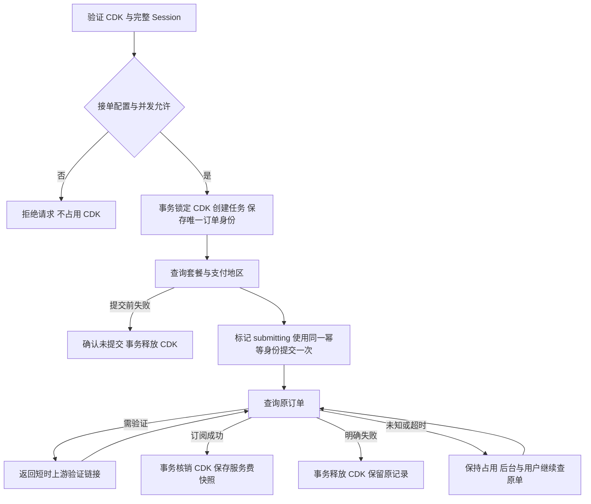

# Orbitcard 充值链路与审计

## 唯一充值入口

用户通过 CDK 提交完整 Session；所有新订阅都调用 Orbitcard 的 `createSubscription`。接单开关关闭、配置缺失或维护中均拒绝新任务，不调用其他支付实现。旧卡池、浏览器、代理、账单地址、支付链接和验证码求解入口已删除。

## 输入和事务

Session 必须是 JSON 对象，包含 `user`、`account`、字符串 `accessToken`（兼容 `access_token`）和有效邮箱；存在 `expires` 时不能过期。凭据真实性由 Orbitcard 校验。系统不进行本地浏览器登录。

先查询卡密已有任务；有订单时恢复原订单，有历史待确认任务时保留人工核对状态。新任务需通过维护、接单配置和并发检查。并发名额在异步创建任务之前占用，避免并发请求突破本机容量。

创建任务的事务先锁定 CDK，检查类型、套餐、是否已用及未结束任务，再创建任务、保存唯一 `client_order_no`、标记 CDK 占用。完整 Session 不传给任务写库函数，只在当前请求和工作流内存中使用。

## 提交和结果确认

创建订阅之前持久化 `submitting`；随后使用同一订单身份作为幂等键签名。网络超时、HTTP 错误、平台错误码或本地任务超时都不能单独证明没有受理。

平台明确返回 `submission_outcome=rejected` 时可释放 CDK；否则保留身份，仅查询 `task_no` 或 `client_order_no`。查询结果先核对订单、套餐及账号归属，再结算。

| 阶段 | 任务 / 订单状态 | CDK |
| --- | --- | --- |
| 已建任务未提交 | `prepared` | 占用 |
| 可能已发送 | `submitting` | 占用 |
| 等待上游或验证 | `pending` / `running` | 占用 |
| 结果未知或超时 | `manual` | 继续占用 |
| 明确订阅成功 | `success` | 核销 |
| 明确订阅失败 / 拒绝提交 | `failed` / `rejected` | 释放 |

结算事务按同一顺序锁 CDK 和任务，确认当前是该 CDK 最新任务。旧任务不能释放新任务的占用，已确认成功不降级为失败。明确失败后的新兑换才会生成新的订单身份。

服务费独立于订阅结果。`payment.amount/currency` 是银行卡支付金额快照；`service_fee/currency/fee_status` 是平台服务费。`charge_failed` 不代表订阅失败，`charge_pending` 继续查询最新收费快照。本项目不把 API 服务费写成虚构的本地卡池账单。

## 查询、验证与重启

用户通过原 CDK 查询，管理员通过原任务查询。自动查询中并发请求合并，连续查询至少间隔 5 秒，并遵守 `Retry-After`。前台自动跟踪最多 15 分钟，之后可手动查询。

服务启动后恢复持久化的原订单。明确停在 `prepared` 且本机无工作任务的订单可按“从未提交”释放；`submitting/pending/manual` 只查询，不自动再次创建订阅。后台跳过当前前台工作流，失败查询采用退避并轮流处理其他任务。停用新接单不影响已有原单查询，但需保留原平台和有效凭据。

验证码仅使用上游 HTTPS 链接；只在当前响应和内存中保留，前端检查到期时间。后台恢复也不需要保存用户 Session。工作流不进行本地识图、填写银行卡或直接取消续费。

历史非 Orbitcard 运行任务迁移为人工核对，保持卡密占用。不能把这些记录交给 Orbitcard 自动补单，也不能根据旧日志猜测支付失败。

## 日志与权限

| 位置 | 内容 |
| --- | --- |
| `task_logs` | 当前状态、CDK、原订单身份、账号预览、最新安全摘要 |
| `data/logs/task-<jobKey>.jsonl` | 按任务保存的请求、响应摘要、状态变化和恢复事件 |
| `data/logs/runtime-YYYY-MM-DD.jsonl` | 按 UTC 日期保存的运行事件 |
| 后台“下载日志” | 管理员认证后下载对应完整任务文件 |

实际 HTTP 请求记录开始/结束、耗时、操作、HTTP 状态、平台码、请求结果类型、原订单身份及服务费/支付金额白名单字段。不会写 Session 请求体、API Key、HMAC Secret、签名、验证码凭据或含原始请求的 Axios 错误对象。

CDK 与订单关联记录不提供删除接口；有历史任务或使用记录的 CDK 也不允许删除。CDK 管理要求管理员登录与二级验证。WebSocket 订阅要求对应 CDK 或当前有效管理员令牌。

后台显示缓存有条数限制，磁盘完整 JSONL 独立保留。清空缓存不会删除文件；重启从最近日志末尾恢复显示。磁盘不可写、数据库中断或主机损坏仍需运维介入，不能承诺这些情况下完整保存全部证据。升级前已丢失的日志无法补录。

旧数据库可能仍含历史完整 Session、银行卡等敏感数据；升级不会自动删除或脱敏这些旧记录，备份仍需限制访问。

## 代码与验证

| 模块 | 职责 |
| --- | --- |
| `activation-service.js` | 输入校验、接单门禁、并发名额、创建与调度 |
| `orbitcard-cdk-store.js` | CDK 与原单绑定、事务结算和防止旧任务回滚 |
| `orbitcard-client.js` / `orbitcard-worker.js` | HMAC 请求、只创建一次、原单轮询 |
| `orbitcard-query.js` / `order-recovery.js` | 查询合并、限流、重启恢复 |
| `mysql-core.js` / `mysql-store.js` | 数据库、安全配置、核心表迁移及历史保护 |
| `runtime-log.js` / `log-safety.js` | 持久化审计及敏感字段过滤 |
| `server.js` / `admin-http.js` | 用户与管理员 HTTP、任务订阅 |

`npm test` 使用 Node 内置测试、模拟上游和事务存储，以及本机 HTTP 服务验证流程。不发起真实充值，不能替代部署后的 MySQL 迁移、镜像构建、日志权限或平台连接验证。
