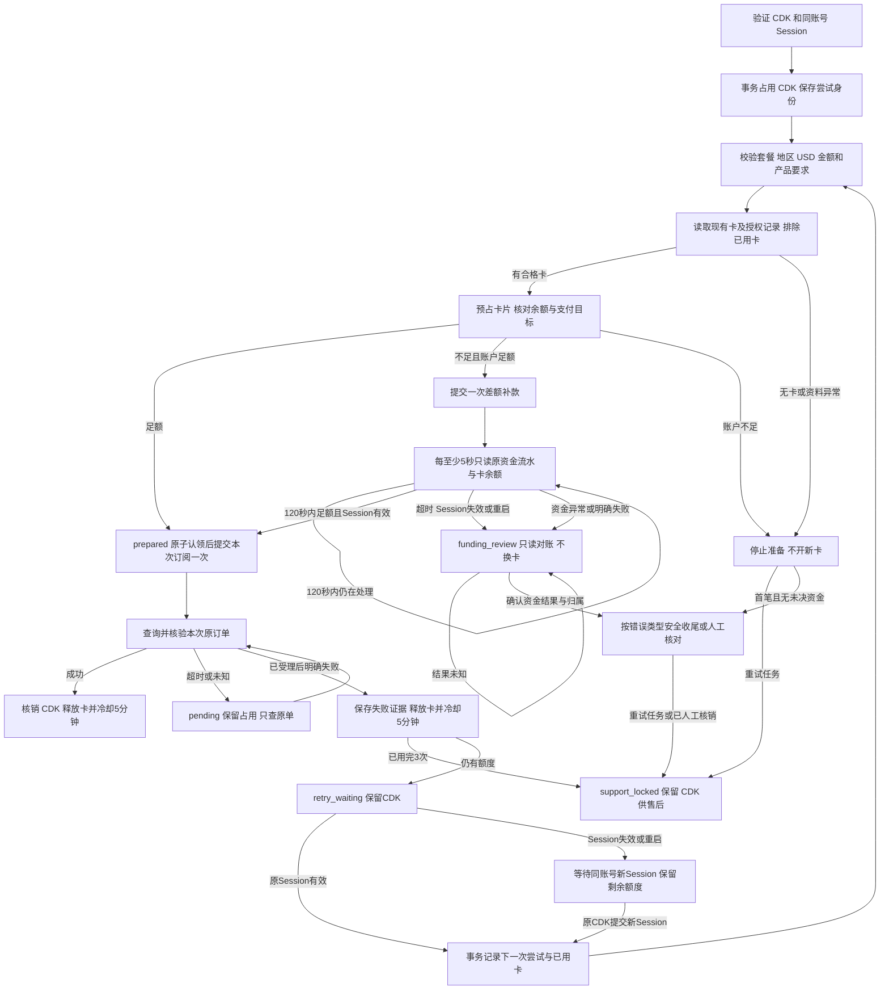

# Orbitcard 充值链路与审计

## 唯一充值入口

用户通过 CDK 提交完整 Session；所有新订阅都调用 Orbitcard 的 `createSubscription`。接单开关关闭、配置缺失或维护中均拒绝新任务，不调用其他支付实现。旧卡池、浏览器、代理、账单地址、支付链接和验证码求解入口已删除。

`orbitcard-api-contract.js` 按 Open API 和订阅 API 限制出站操作名与顶层字段，校验定点金额字符串及写操作幂等键；订单归属与原请求恢复仍由业务层处理。清理旧兼容入口和冗余展示不改变 CDK、订阅、资金及历史任务的状态规则。

## 输入和事务

Session 必须是 JSON 对象，包含 `user`、`account`、字符串 `accessToken`（兼容 `access_token`）和有效邮箱；存在 `expires` 时不能过期。凭据真实性由 Orbitcard 校验。系统不进行本地浏览器登录。

先查询卡密已有任务；有订单时恢复原订单，有历史待确认任务时保留人工核对状态。新任务需通过维护、接单配置和并发检查。并发名额在异步创建任务之前占用，避免并发请求突破本机容量。

在任务创建前取得按 CDK 归一化标识生成的 MySQL 命名执行锁，直到后台支付完成或转入待确认才释放。管理员订单按请求编号取得执行锁；人工交付额外取得同一 CDK 锁。所有锁按稳定顺序申请，抢占失败不进入选卡或资金准备。恢复任务和手动查单使用相同执行锁，并在取得锁后重新读取最新状态。锁连接独立于业务连接池，结束或异常时断开连接释放锁，避免复用连接遗留所有权。

只含数据库操作的事务遇到 MySQL 1213 死锁或 1205 锁等待超时，在回滚成功后最多尝试 3 次并短暂随机退避。提交结果不明或回滚失败不重放，失败连接不返回连接池。开卡、补款和订阅接口调用不在这个数据库重试机制中。

写入补款意图时在同一事务重新锁定订单和卡片，检查任务状态及卡片归属。释放准备中的 CDK 时，再次锁定并检查未结束的开卡/补款意图，避免恢复任务用较早的无意图快照误释放。旧失败/拒绝终态不可被迟到查询重新打开；平台订单号一旦绑定，其他订单号不能覆盖。管理员未提交的准备单也不能直接结算。

创建任务的事务先锁定 CDK，检查类型、套餐、是否已用及未结束任务，再创建 `preparing` 任务，保存唯一 `client_order_no` 并占用 CDK；并发请求只能创建一笔。Session 不传给写库函数，只留在请求和工作流内存。四档默认地区保存于 `orbitcard_payment_regions`：「平台默认」省略 `payment_region`；指定地区在选卡及补款前调用 `getSubscriptionPaymentRegions` 校验，失败或失效时停止，不回退。用户兑换和管理员开通共用该逻辑。已提交订单只查原单，修改地区不触发重提。

之后读取 `orbitcard_plan_prices` 套餐 USD 金额及产品最低留存，缺配置时停止，不从历史订单或 USDT 服务费推测。MySQL 命名锁保护同步和选卡，只选 ACTIVE、USD、资料完整、成功授权不足 7 次、冷却结束且未占用的现有卡，重试排除此前用过的卡。卡内足额准备订阅；不足计算“套餐金额＋最低留存－卡余额”，与账户 `available_balance` 比较，不扣其他卡余额，足够才保存意图并补一次差额。首笔准备失败安全释放无未决资金占用，重试准备失败保留 CDK 售后锁定。任何订单、后台维护和同步卡片都不自动开卡；管理员手动申请保留。释放且冷却到期、仅新增授权待同步的卡继续排除，冻结闲卡也排除，有其他合格卡时继续选。后台只同步和退役，不补位；成功授权按交易 ID 去重，本地订阅成功不重复加次数。详见 [ORBITCARD-CARDS.md](ORBITCARD-CARDS.md)。

## 提交和结果确认

卡片与资金就绪后，任务从 `preparing` 或 `funding_waiting` 转为 `prepared`。每次尝试提交前，在事务中锁定 CDK 和任务，校验该次固定 `client_order_no` 与 `prepared` 状态，仅允许一个执行者认领 `submitting`；未认领成功不得调用 `createSubscription`，也不能恢复为 `prepared`。以同一尝试身份作为平台幂等键签名。选卡及资金准备由命名锁和持久化原意图保护，无需 Redis。网络超时、HTTP 错误、平台错误码或本地超时不能单独证明未受理，未知结果保持 `pending`，只查原订阅，不自动转人工或换卡。

平台详情明确 `subscription_succeeded=false` 或上游订阅状态 `failed`，且当前订单号、套餐、账号、卡 ID 等归属一致时，才记录已确认失败。来源不明的快照或状态与成功标志矛盾时继续查原单；仅当 `query_source=snapshot`、`result_source=upstream` 且三个终态字段明确一致时，才接受上游终态快照。自助和管理员订单确认失败后，保存脱敏原因，事务释放本次卡并冷却 5 分钟，CDK 保持占用。仍有额度时进入 `retry_waiting`，最多换两张不同现有卡重试，总计最多 3 次。无卡、重试准备失败或次数耗尽才进入 `support_locked`。HTTP 错误、超时、查询失败、服务费失败及本地任务 `failed` 均不单独构成换卡依据；资金异常或未决也不能换卡。

自助重试复用已有 `orbitcard_retry_root_job_key`、`orbitcard_retry_attempt_no`、前两张卡 ID 字段及子任务：事务内确认本任务仍是 CDK 最新任务、失败证据与身份一致，才创建下一次 `preparing` 子任务，旧任务保留失败结果。管理员保持原 `request_id`，更新本次 `client_order_no`，把旧失败订单身份、卡片与安全摘要追加到 `retry_history MEDIUMTEXT`；该列由启动迁移补齐。次数和已用卡持久化，选卡及最终预占均排除已用卡，重启或重复提交不重置额度。

Session 只保留内存，不写数据库、浏览器存储或日志。管理员最多保留 64 份、15 分钟，并检查 Session 自身有效期。原 Session 有效时可自动续试；失效、丢失或重启后保持 `retry_waiting`，要求原 CDK 或原管理员 `request_id` 与同账号新 Session，经原平台及 API Key 身份校验后继续剩余额度。无可核验失败证据的历史 `retry_waiting` 不自动付款，保留售后；普通 `manual` 和已售后锁定任务不恢复。

首笔订单明确返回 `submission_outcome=rejected` 时进入 `rejected` 并释放 CDK 与支付卡，不新增消费冷却；重试中拒绝或准备失败保留 CDK 供售后。其他提交结果不明保持 `pending`，仅查询原 `task_no` 或 `client_order_no`。查询先核对订单、套餐及账号归属，再结算；历史 `manual` 保留人工状态。

| 阶段 | 任务 / 订单状态 | CDK |
| --- | --- | --- |
| 已建任务，正在准备卡片和资金 | `preparing` / `running` | 占用；兼容读取旧 `prepared` 准备记录 |
| 卡片和资金已就绪，尚未提交 | `prepared` / `running` | 占用；可原子认领一次订阅提交 |
| 新任务账户可用余额不足补款差额 | `rejected` / `failed` | 报错并释放没有未决资金操作的 CDK 与卡片 |
| 历史账户余额锁定任务 | `balance_blocked` / `failed` | 保留原恢复逻辑；新任务不进入此状态 |
| 个别卡异常或达到 7 次成功消费授权 | 继续选现有卡或暂停 | 达限空闲卡由维护退役，不补位；任何订单都不自动开卡 |
| 只有占用中的候选卡，或成功消费授权次数尚未确认 | 暂停选卡 | 等待原订单或同步平台授权记录；不把未知次数当作零次 |
| 卡片已释放且冷却到期，仅新增授权仍未同步 | 排除该卡，继续选现有卡 | 保留旧卡授权门槛；无其他合格卡时停止，不开卡 |
| 准备记录临时无法读取 | `preparing` 或旧 `prepared` / `manual` | 保留 CDK 与支付卡，不查询尚未创建的订阅 |
| 批量详情整体缺失或归属异常 | `support_locked` / `failed` | 锁定，提示联系人工售后；不盲目开卡 |
| 后台维护时卡片数量变化 | 不自动开卡 | 仅管理员手动申请新卡；历史未确认申请沿用原身份对账 |
| 已知原补款处理中或余额延迟，订阅未提交 | `funding_waiting` / `running` | 每至少 5 秒只读对账，遵守更长 Retry-After；120 秒内到账足额且 Session 有效时继续原订阅 |
| 补款等待超时、Session 失效或进程重启 | `funding_review` / `manual` | 人工对账工单；后台仅查原资金号，确认 `ready` 或 `failed` 后安全收尾；首笔普通 CDK 释放并要求新 Session，重试 CDK 保持锁定 |
| 补款身份、金额或卡片资料异常 | `funding_pending` / `manual` | 保留原身份；有原订单号时继续只读核对，校验通过且资金终态明确后安全释放，不自动恢复付款 |
| 开卡待确认 | `card_pending` / `manual` | 有原订单号时以原正文和幂等键确认；未发送意图可失败，无订单号的未知申请不重放；确认后安全收尾 |
| 可能已发送 | `submitting` | 占用 |
| 等待上游或验证 | `pending` / `running` | 占用 |
| 原订单返回上游终态快照 | `success`、`retry_waiting` 或 `support_locked` | 归属匹配，`query_source=snapshot`、`result_source=upstream` 且 `status`/`upstream_status`/`subscription_succeeded` 三项明确一致时正常结算；失败是否重试取决于剩余额度与安全条件 |
| 已提交订阅结果未知或超时 | `pending` / `running` | 继续占用，后台查询原单，不自动转人工 |
| 历史人工订阅任务 | `manual` | 保留人工状态，仅核对原单，不恢复付款 |
| 明确订阅成功 | `success` | 核销 |
| 已受理后明确订阅失败 | `retry_waiting` / `running`，或 `support_locked` / `failed` | 保留 CDK，释放失败卡并冷却；最多换两张不同现有卡，无卡、重试准备失败或耗尽转售后 |
| 首笔请求被明确拒绝提交 | `rejected` | 释放，需检查资料后重新提交 |
| 等待重试但 Session 不可用 | `retry_waiting` | 保留额度和占用，用原账号新 Session 续跑；缺少可核验失败证据的旧记录转售后，不付款 |

结算事务按同一顺序锁 CDK 和任务，确认当前是该 CDK 最新任务。旧任务不能释放新任务占用，已确认成功不降级为失败。只有已确认订阅失败且具备剩余额度、同账号及原平台身份、无未决资金操作时，才可事务认领下一次尝试；历史失败身份不被覆盖或重新提交。

同一结算事务继续按卡片、用卡记录顺序加锁：成功释放该任务的卡占用并设置等待新增授权的门槛，不直接增加授权次数；已提交后明确失败只释放本次预占。成功及已提交后失败同时设置 5 分钟卡片冷却，未知状态不释放。写入卡片状态失败时整个任务/CDK/用卡结算回滚。提交前失败只释放当前任务绑定且不存在未决资金操作的卡，不影响其他任务。

服务费独立于订阅结果。套餐目录只用于判断套餐是否开放；目录 `service_fee` 不用于本地选卡、开卡、补款门槛，也不展示在后台目录。若后台配置 `orbitcard_max_fee`，仅随订阅请求发送 `max_service_fee`，由平台在下单时校验。`payment.amount/currency` 是银行卡支付金额快照；订单中的 `service_fee/currency/fee_status` 是实际平台服务费记录，仍保留用于核对。`charge_failed` 不代表订阅失败，`charge_pending` 继续查询最新收费快照。本项目不把 API 服务费写成虚构的本地卡池账单。

## 查询、验证与重启

用户通过原 CDK 查询，管理员通过原任务查询。自动查询中并发请求合并，连续查询至少间隔 5 秒。任何 Open API 请求遇到 HTTP 429 后，同一根域名和 API Key 的后续请求共享 `Retry-After` 冷却时间；每次请求仍独立生成 HMAC 时间戳、随机数与签名。前台自动跟踪最多 15 分钟，之后可手动查询。

服务启动后恢复持久化原订单。停在 `preparing` 或历史 `prepared` 且无未决资金的首笔未提交订单可安全释放；自助重试准备中断保留 CDK 供售后；管理员第 2、3 次尚在准备阶段时，用原请求与同账号新 Session 继续仍沿用当前尝试身份，不重置次数。有原补款号且仍为 `pending`，或停在 `funding_waiting` 时转 `funding_review`，不能用丢失的 Session 续订。`funding_review`、有订单号的 `funding_pending` 只读对账，`card_pending` 按下述原开卡规则确认；资金确认后只安全收尾，不自动付款。`support_locked` 和普通 `manual` 不恢复；`submitting/pending` 与历史人工订阅继续查原单，绝不重发本次订阅。确认失败且尚有额度时可转 `retry_waiting`，重启后须原账号新 Session 继续剩余额度。后台跳过前台工作流，失败查询退避；停用新接单或人工核销不阻断原资金核对，但须原平台及有效凭据。

验证码仅使用上游 HTTPS 链接；只在当前响应和内存中保留，前端检查到期时间。后台恢复也不需要保存用户 Session。工作流不进行本地识图、填写银行卡或直接取消续费。

历史非 Orbitcard 运行任务迁移为人工核对，保持卡密占用。不能把这些记录交给 Orbitcard 自动补单，也不能根据旧日志猜测支付失败。

开卡恢复独立于订阅恢复：停在 `prepared` 的开卡意图按未发送处理，可确认失败；`card_pending` 对应的 `submitting/pending/unknown` 意图仅在保存了平台 `order_no` 时，以原始正文、原 API Key 身份和固定幂等键确认同一申请，并遵守持久化重查时间。无平台订单号的未知意图不自动重放，不切换参数或身份新开卡。等待开卡的充值任务保留 CDK，不查询尚不存在的订阅订单。仅有一致订单号且 `status=success`、有效数字卡 ID 才登记新卡。本地开卡记录已确认 `ready` 或 `failed`，并在事务中验证原申请、卡片归属及无其他未决操作后，`card_pending` 任务可安全收尾；普通 CDK 释放后要求最新 Session，人工核销及支付重试的 CDK 保持锁定。恢复本身不提交会员充值，资源收尾不依赖消费授权同步。

账户余额门槛仅使用 `available_balance`，只在卡内不足时与补款差额比较，不扣除其他卡片余额；首笔不足则直接报错并释放没有未决资金操作的未提交任务，重试准备失败保持 CDK 售后锁定。选卡时卡片状态先于次数和余额筛选，非 ACTIVE 不可选。补款提交前及确认后核对卡片资金，每至少 5 秒只读查询原流水与余额，更长 `Retry-After` 优先；原 Session 续跑等待最多 120 秒。已知原资金订单仍处理中、查询临时失败或余额未同步时保留等待，在两次核对之间释放全局卡分配锁。窗口内原任务执行锁与卡片占用保留，不能把尚未确认的资金转给其他任务；其他卡的分配不受这段等待锁阻塞，任务仍计入并发容量。卡片资料异常则停止自动处理并保留人工核对。

补款独立于订阅：原意图及请求身份先落库。有订单号时用 `getCardFlow(type:"recharge")` 按原 `order_no` 精确核对，未查到不能推断失败。异步对账绝不调用 `rechargeCard`；缺少原平台订单号、金额/身份不匹配或无效卡资料时转人工，不凭余额变化认领资金结果。平台成功后还需实时卡片 ACTIVE、USD 和余额足够。

补款延迟期间，自助与管理员仅在 120 秒窗口内用原内存 Session 续跑；到账足额且 Session 有效后原子认领本次订阅一次。超时、Session 失效或重启转 `funding_review`，后台只读原资金号，不重新补款或换卡。带原订单号的 `funding_pending` 也可只读核对，身份、金额异常须校验通过；补款成功且卡片 ACTIVE、USD、余额足额才记 `ready`。确认 `ready` 或明确 `failed` 后，事务复核归属及无其他未决操作，再释放未提交卡片和普通首笔 CDK，要求最新 Session（管理员首笔需新请求编号）。已人工核销及支付重试 CDK 保持锁定，资金收尾不依赖授权同步；未知资金不能仅因超时释放。此资金恢复复用原资金表与状态；管理员换卡历史另新增 `retry_history` 列，无新增环境变量。历史 `balance_blocked` 仍按原规则恢复，新任务账户不足直接失败。

## 日志与权限

后台“人工修改订单”只用于已提交订阅的结果核对。准备中、补款等待或 `funding_review` 对账工单不能直接标为订阅成功或失败；事务内还会锁定原开卡、补款记录，存在未决资金操作时拒绝结算，避免提前释放支付卡。资金确认结束后由恢复流程安全释放未提交任务。

| 位置 | 内容 |
| --- | --- |
| `task_logs` | 各次状态、CDK、根任务与重试序号、已用卡、原订单身份、账号预览和安全摘要 |
| `orbitcard_admin_orders.retry_history` | 管理员旧失败尝试的订单身份、卡片及安全结果；Session 不落库 |
| `orbitcard_managed_cards` / `orbitcard_card_authorizations` / `orbitcard_card_uses` | 成功消费授权次数及唯一 ID、卡片占用及每次尝试的预占/结算状态 |
| `orbitcard_card_fundings` | 固定补款身份、原卡/金额、目标余额、订单及费用结果；不覆盖未知订单 |
| `orbitcard_card_issues` | 固定申请身份、产品、首充金额及开卡结果；不删除待确认身份 |
| `TASK_LOG_DIR/YYYY-MM-DD/task-<jobKey>.jsonl` | 按北京时间日期和任务保存的请求、响应摘要、状态变化及恢复事件 |
| `TASK_LOG_DIR/runtime-YYYY-MM-DD.jsonl` | 按北京时间日期保存的运行事件 |
| 后台“下载日志” | 管理员认证后下载对应完整任务文件 |

支付前记录 `card_funds_before_subscription` 与 `card_payment_preflight`，成功后只读复查卡余额、账户可用余额和首批消费交易数量，写入 `payment_funds_snapshot`。后台“卡片与开卡”可按卡查看脱敏交易；完整分页按成功 Authorization 的交易 ID 去重，不检查金额，清算等不增加次数。满 7 次停止分配，空闲卡由维护删除，不补位；订单缺卡也不开卡。订阅成功不直接加次数，授权待同步的旧卡继续排除，其他合格现有卡仍可选择。交易记录不能核销 CDK 或确认订阅成功，结论以归属核验后的 `getSubscription` 为准；只读对账失败不改变已确认订阅结论。

实际 HTTP 请求记录开始/结束、耗时、操作、HTTP 状态、平台码、请求结果类型、原订单身份及服务费/支付金额白名单字段。不会写 Session 请求体、API Key、HMAC Secret、签名、验证码凭据或含原始请求的 Axios 错误对象。

CDK 与订单关联记录不提供删除接口；有历史任务或使用记录的 CDK 也不允许删除。CDK 管理要求管理员登录与二级验证。WebSocket 订阅要求对应 CDK 或当前有效管理员令牌。

后台显示缓存有条数与容量限制，完整 JSONL 独立写磁盘；清空缓存不删除文件，重启从最近日志末尾恢复显示。运行与任务日志按北京时间日期保留当天及前 14 天，每日零点清理，启动补清理；默认路径为 Linux `/var/log/pay-gpt-orbit` 或 Windows 系统盘 `ProgramData/Pay-gpt-Orbit/logs`，可用 `TASK_LOG_DIR` 配置，Compose 宿主目录用 `APP_LOG_DIR`。磁盘不可写、数据库中断或主机损坏仍需运维，升级前丢失日志无法补录。详见 [日志存储与迁移](DEPLOY.md#环境更新与存储)。

旧数据库可能仍含历史完整 Session、银行卡等敏感数据；升级不会自动删除或脱敏这些旧记录，备份仍需限制访问。

## 代码与验证

| 模块 | 职责 |
| --- | --- |
| `activation-service.js` | 输入校验、接单门禁、并发名额、创建与调度 |
| `payment-execution-lock.js` / `mysql-transaction.js` | 跨进程执行互斥、连接失效检查、仅数据库事务的有界冲突重试 |
| `plan-registry.js` | 四档本地套餐、平台套餐映射及历史套餐别名 |
| `payment-service.js` / `payment-retry-policy.js` | 自助尝试编排、确认失败判定、次数上限、已用卡排除及结算通知 |
| `orbitcard-cdk-store.js` | CDK 与原单绑定、事务结算和防止旧任务回滚 |
| `orbitcard-client.js` | HMAC 请求、超时和平台限流、响应安全摘要 |
| `orbitcard-subscription-service.js` | 自助、管理员和恢复共用的参数校验、下单正文、原单归属与结果判定 |
| `orbitcard-worker.js` | 单次订阅尝试、持久化认领、提交一次和原单轮询 |
| `orbitcard-query.js` / `order-recovery.js` | 查询合并、限流、重启恢复 |
| `orbitcard-payment-decision.js` | 对现有卡快照作出支付、补款、等待或拒绝决策，不包含网络或数据库操作，也不自动开卡 |
| `orbitcard-cards-client.js` / `orbitcard-card-service.js` | 账户可用余额、批量选卡、配置的 USD 支付预算、补款及管理员开卡恢复 |
| `orbitcard-manual-service.js` / `orbitcard-manual-store.js` | 测试及人工交付、并发占位、失败历史、Session 内存续试与原单恢复 |
| `orbitcard-money.js` / `orbitcard-funding-service.js` | 十进制差额、幂等补款、原流水恢复和卡余额复核 |
| `orbitcard-card-store.js` / `orbitcard-card-http.js` | 持久化成功消费授权 ID、计数和申请，同事务预占结算及管理员卡片入口 |
| `mysql-core.js` / `mysql-store.js` | 数据库、安全配置、核心表迁移及历史保护 |
| `runtime-log.js` / `log-safety.js` | 持久化审计及敏感字段过滤 |
| `server.js` / `admin-http.js` | 用户与管理员 HTTP、任务订阅 |

`npm test` 使用 Node 内置测试、模拟上游和事务存储，以及本机 HTTP 服务验证流程。不发起真实充值，不能替代部署后的 MySQL 迁移、镜像构建、日志权限或平台连接验证。

支付流程独立于 HTTP：先校验 Session、套餐和订单编号，再准备现有卡及资金，原资金优先对账，每次原子认领后只提交一次。换卡必须有确认失败证据，最多追加两次不同现有卡尝试；自助子任务和管理员 retry_history 保留各笔旧失败身份。原 API Key 指纹必须匹配，管理员还须匹配原平台；缓存不能绕过校验。尚在准备的管理员订单不查订阅，提交后刷新遵守间隔。有效 `retry_waiting` 可用同账号新 Session 继续剩余额度，缺少证据的历史记录不能自动付款。

## 调试与日志

「调试与日志」统一入口含「接口查询」「支付预检与测试」「订单链路」「运行日志」「登录记录」。管理员订单列表归入「订单链路」，显示第 N / 3 次和历史卡片日志，订单行保留快捷入口；「手动开通」只留人工交付，真实测试唯一入口在「支付预检与测试」，旧 `#logs` 自动进入运行日志。Telegram 发送测试位于「接口查询」的独立通知面板，使用已保存通知配置真实发送消息，设置页保留快捷入口；卡台查询面板仍只读。

只读预检用独立 debug 编号串联阶段，复用正式选卡纯判断读取快照，不分配、不预占、不写同步状态，也不开卡、补款或创建订阅。真实测试复用管理员订单的原子认领、最多三次现有卡尝试及原单恢复。读取套餐前绑定 auditJobKey，使地区、账户、产品、卡片、补款及订阅事件写入对应任务链路；手动申请和历史开卡恢复保留各自审计身份。Session 校验、参数及归属核对日志共用脱敏规则。

日志读取接口要求二级验证，按文件字节游标分页，校验任务名和换行边界，不允许路径穿越。读取现有日志时再次脱敏，支持清空缓存或进程重启后继续查看；不伪造升级前不存在的步骤记录。产品推荐价依赖已移除，后台配置每档 USD 卡支付金额，按配置与实时产品留存要求计算差额补款。

## 2026-10-22 代码整理与支付复核（历史记录）

本轮按生产入口与实际调用关系删除了 `gpt-api-client.js` 转发层、未调用的 API Key 遮罩函数、两个旧配置写入函数，以及支付 worker 的空回调。历史数据迁移和旧套餐别名仍用于读取存量订单，继续保留。

已修复并添加回归场景：

- **重试订单恢复时提前释放卡片**：第二、三次支付尝试在 `prepared` 阶段中断时，先核对原开卡和补款意图，再决定转人工。资金结果未知时转为 `card_pending` / `funding_pending` 并保留卡片；售后锁定事务也重新检查待确认资金记录，防止旧快照释放卡片。
- **余额恢复串用 API 账号**：余额锁定任务含原 API Key 指纹时，恢复前验证当前指纹，避免用另一账号的余额解除原 CDK 锁定。
- **前台重试入口被隐藏**：查询返回 `retry` 后显示 Session 表单，允许继续原账号的支付尝试；查询失败或网络异常时清除旧验证码入口。
- **限流等待时间丢失**：分别解析各层重试提示，忽略无效值，并取有效值中的最长等待时间；异常正文不再使有效 `Retry-After` 失效。
- **重复对账查询**：订阅后的只读对账从四次平台请求减至三次，卡片详情只读取一次；账户、卡片与交易查询仍独立保留成功证据。

以下结果仅记录 2026-10-22 版本：验证使用模拟数据库、平台及前端 DOM，不发起真实开卡、充值或订阅；当时 `npm test` 为 195 项通过（原 189 项，新增 6 项），该次发布未新增环境变量、依赖或数据库字段。当前版本的管理员换卡历史需要上述 `retry_history` 启动迁移，测试数量以本次运行结果为准。

尚需部署环境验证的边界：真实 MySQL 的多连接竞争和断连恢复，以及真实平台的失败、限流与流水返回。当前接单容量由进程内集合控制，多实例部署时不是全局容量上限；选卡与资金提交仍由分配锁串行协调，补款两次只读核对之间释放全局分配锁。多实例吞吐仍受平台限流、数据库执行锁容量和正在等待的任务数量约束。
