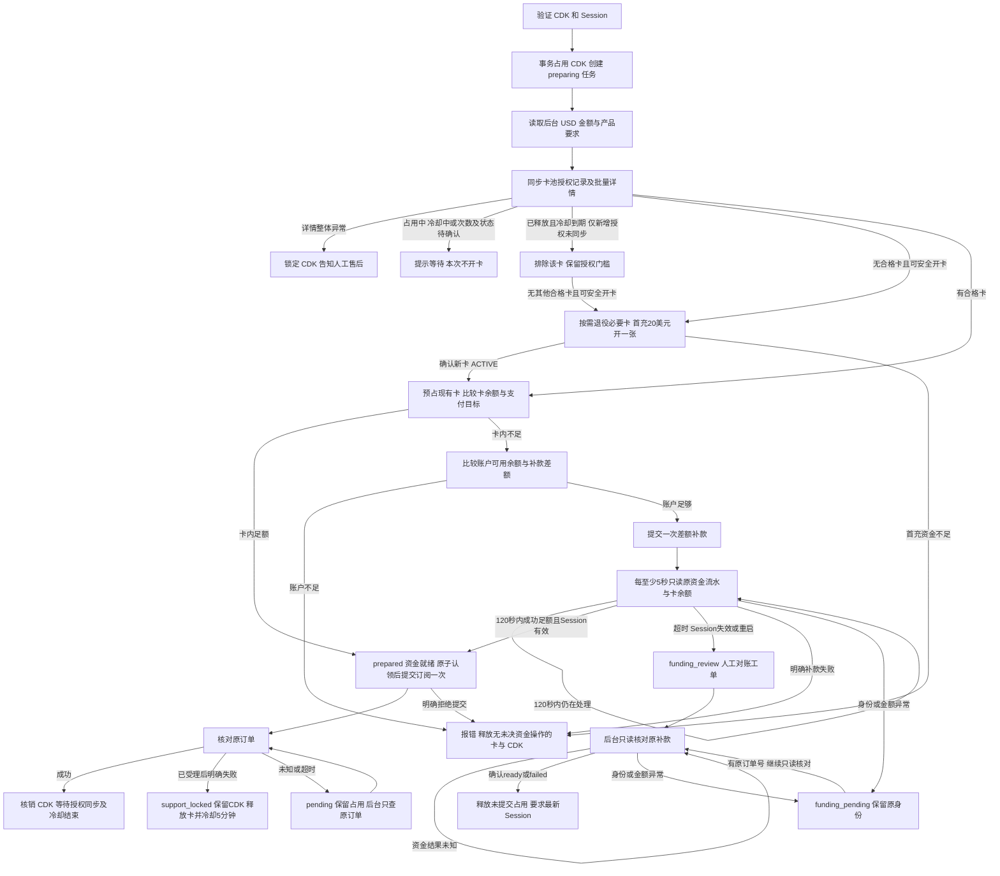

# Orbitcard 充值链路与审计

## 唯一充值入口

用户通过 CDK 提交完整 Session；所有新订阅都调用 Orbitcard 的 `createSubscription`。接单开关关闭、配置缺失或维护中均拒绝新任务，不调用其他支付实现。旧卡池、浏览器、代理、账单地址、支付链接和验证码求解入口已删除。

`orbitcard-api-contract.js` 按 Open API 和订阅 API 限制出站操作名与顶层字段，校验定点金额字符串及写操作幂等键；订单归属与原请求恢复仍由业务层处理。清理旧兼容入口和冗余展示不改变 CDK、订阅、资金及历史任务的状态规则。

## 输入和事务

Session 必须是 JSON 对象，包含 `user`、`account`、字符串 `accessToken`（兼容 `access_token`）和有效邮箱；存在 `expires` 时不能过期。凭据真实性由 Orbitcard 校验。系统不进行本地浏览器登录。

先查询卡密已有任务；有订单时恢复原订单，有历史待确认任务时保留人工核对状态。新任务需通过维护、接单配置和并发检查。并发名额在异步创建任务之前占用，避免并发请求突破本机容量。

在任务创建前取得按 CDK 归一化标识生成的 MySQL 命名执行锁，直到后台支付完成或转入待确认才释放。管理员订单按请求编号取得执行锁；人工交付额外取得同一 CDK 锁。所有锁按稳定顺序申请，抢占失败不进入选卡或资金准备。恢复任务和手动查单使用相同执行锁，并在取得锁后重新读取最新状态。锁连接独立于业务连接池，结束或异常时断开连接释放锁，避免复用连接遗留所有权。

只含数据库操作的事务遇到 MySQL 1213 死锁或 1205 锁等待超时，在回滚成功后最多尝试 3 次并短暂随机退避。提交结果不明或回滚失败不重放，失败连接不返回连接池。开卡、补款和订阅接口调用不在这个数据库重试机制中。

写入补款意图时在同一事务重新锁定订单和卡片，检查任务状态及卡片归属。释放准备中的 CDK 时，再次锁定并检查未结束的开卡/补款意图，避免恢复任务用较早的无意图快照误释放。旧失败/拒绝终态不可被迟到查询重新打开；平台订单号一旦绑定，其他订单号不能覆盖。管理员未提交的准备单也不能直接结算。

创建任务的事务先锁定 CDK，检查类型、套餐、是否已用及未结束任务，再创建 `preparing` 任务、保存唯一 `client_order_no`、标记 CDK 占用。同一 CDK 的并发请求只能创建一笔新任务。完整 Session 不传给任务写库函数，只在当前请求和工作流内存中使用。四档默认充值地区保存在 `orbitcard_payment_regions` 中。选择「平台默认」时省略 `payment_region`；指定地区时在选卡、补款或开卡前调用 `getSubscriptionPaymentRegions` 校验，查询失败或地区失效时停止，不回退到其他地区。用户兑换和管理员开通共用此逻辑。已提交的订单继续按原订单号查询，修改默认地区不会触发重提。

之后读取后台 `orbitcard_plan_prices` 中的套餐 USD 金额和实时产品最低留存要求；未配置金额时停止代充，不从产品字段、历史订单或 USDT 服务费推测。先通过 MySQL 命名锁同步卡列表、批量详情及成功授权记录，选择 ACTIVE、USD、资料完整、授权不足 7 次、冷却结束且未占用的现有卡。卡内足额则准备订阅；不足才计算“套餐金额＋最低留存－卡余额”，与账户 `available_balance` 比较，不扣除其他卡片余额。账户不足时直接失败，释放没有未决资金操作的未提交任务；足够时保存原补款意图并补一次差额。主流程不先补满卡池，确实无可用卡时只按需退役必要卡并首充 20 USD 开一张；后台每分钟及同步卡片只更新资料和处理退役，不自动补卡；本地卡池不设数量上限。真正占用、冷却未结束、未知授权次数或卡状态、整批详情异常及未决开卡/删卡操作仍阻止新开卡。已释放且冷却到期、仅新增授权待同步的卡继续禁止复用，但不阻塞另一笔订单按需开卡；已知冻结的空闲卡先排除，避免旧授权门槛造成整池等待。有其他合格现有卡时仍优先使用现有卡。成功授权按平台交易 ID 去重累计，清算和本地订阅成功不重复加次数。详见 [ORBITCARD-CARDS.md](ORBITCARD-CARDS.md)。

## 提交和结果确认

卡片与资金就绪后，任务从 `preparing` 或 `funding_waiting` 转为 `prepared`。创建订阅之前，在 MySQL 事务中锁定 CDK 和任务，校验固定 `client_order_no` 与当前 `prepared` 状态，只允许一个执行者原子转换到 `submitting`。未认领成功的执行者停止，不能把任务恢复成 `prepared`，也不能调用 `createSubscription`。随后以同一订单身份作为平台幂等键签名。选卡、开卡和补款由现有 MySQL 命名锁及持久化原意图保护，无需新增 Redis 服务。网络超时、HTTP 错误、平台错误码或本地任务超时都不能单独证明没有受理；结果未知保持 `pending`，后台仅查询原订阅订单，不自动转为 `manual`。

平台详情明确 `subscription_succeeded=false` 或上游订阅状态 `failed`，且返回当前订单的 `client_order_no`、套餐、账号、卡 ID 归属一致时，才把本笔记录为已确认失败。详情若标为快照，或状态与成功标志互相矛盾，则继续保留原单待核对。自助和管理员订单已受理后明确失败，均在事务中进入 `support_locked`，保持 CDK 占用、释放支付卡并设置 5 分钟冷却；保存脱敏失败原因并提示售后，不再创建下一笔订阅。HTTP 错误、超时、查询失败或平台仅报告本地任务 `failed` 时不视为订阅明确失败。

重启后查询确认订阅失败即结束任务，不创建下一次尝试。旧版本留下的 `retry_waiting` 记录在事务内转为 `support_locked`，不要求用户提交 Session 恢复付款；已有资金意图继续按原记录核对，各笔历史任务保留审计。

订单明确返回 `submission_outcome=rejected` 时进入 `rejected` 并释放 CDK 与支付卡，不新增消费冷却。其他提交结果不明时进入 `pending`，保留身份，仅查询原 `task_no` 或 `client_order_no`。查询结果先核对订单、套餐及账号归属，再结算；历史 `manual` 任务继续保留人工状态，不自动恢复付款。

| 阶段 | 任务 / 订单状态 | CDK |
| --- | --- | --- |
| 已建任务，正在准备卡片和资金 | `preparing` / `running` | 占用；兼容读取旧 `prepared` 准备记录 |
| 卡片和资金已就绪，尚未提交 | `prepared` / `running` | 占用；可原子认领一次订阅提交 |
| 新任务账户可用余额不足补款差额 | `rejected` / `failed` | 报错并释放没有未决资金操作的 CDK 与卡片 |
| 历史账户余额锁定任务 | `balance_blocked` / `failed` | 保留原恢复逻辑；新任务不进入此状态 |
| 个别卡异常或达到 7 次成功消费授权 | 继续选卡或暂停 | 达限的空闲卡确认删除后，仅在订单缺卡时按需开一张；不因数量触发删卡或阻止开卡 |
| 只有占用中的候选卡，或成功消费授权次数尚未确认 | 暂停选卡 | 等待原订单或同步平台授权记录；不把未知次数当作零次 |
| 卡片已释放且冷却到期，仅新增授权仍未同步 | 排除该卡，继续选卡 | 旧卡保持禁止复用；无其他合格卡且无未决操作时可按需开一张 |
| 准备记录临时无法读取 | `preparing` 或旧 `prepared` / `manual` | 保留 CDK 与支付卡，不查询尚未创建的订阅 |
| 批量详情整体缺失或归属异常 | `support_locked` / `failed` | 锁定，提示联系人工售后；不盲目开卡 |
| 后台维护时卡片数量变化 | 保持现有数量，不自动开卡 | 支付主流程仅缺卡时按需开一张，管理员可手动申请；历史未确认申请沿用原身份对账 |
| 已知原补款处理中或余额延迟，订阅未提交 | `funding_waiting` / `running` | 每至少 5 秒只读对账，遵守更长 Retry-After；120 秒内到账足额且 Session 有效时继续原订阅 |
| 补款等待超时、Session 失效或进程重启 | `funding_review` / `manual` | 人工对账工单；后台仅查原资金号，确认 `ready` 或 `failed` 后安全释放并要求最新 Session |
| 补款身份、金额或卡片资料异常 | `funding_pending` / `manual` | 保留原身份；有原订单号时继续只读核对，校验通过且资金终态明确后安全释放，不自动恢复付款 |
| 开卡待确认 | `card_pending` / `manual` | 有原订单号时以原正文和幂等键确认；未发送意图可失败，无订单号的未知申请不重放；确认后安全收尾 |
| 可能已发送 | `submitting` | 占用 |
| 等待上游或验证 | `pending` / `running` | 占用 |
| 已提交订阅结果未知或超时 | `pending` / `running` | 继续占用，后台查询原单，不自动转人工 |
| 历史人工订阅任务 | `manual` | 保留人工状态，仅核对原单，不恢复付款 |
| 明确订阅成功 | `success` | 核销 |
| 已受理后明确订阅失败 | `support_locked` / `failed` | 自助和管理员均保留 CDK，释放卡片并冷却，转人工售后 |
| 首笔请求被明确拒绝提交 | `rejected` | 释放，需检查资料后重新提交 |
| 历史等待重试任务 | `support_locked` | 停止付款，保留占用，转人工售后 |

结算事务按同一顺序锁 CDK 和任务，确认当前是该 CDK 最新任务。旧任务不能释放新任务的占用，已确认成功不降级为失败。明确订阅失败后停止，不再生成新的付款身份。

同一结算事务继续按卡片、用卡记录顺序加锁：成功释放该任务的卡占用并设置等待新增授权的门槛，不直接增加授权次数；已提交后明确失败只释放本次预占。成功及已提交后失败同时设置 5 分钟卡片冷却，未知状态不释放。写入卡片状态失败时整个任务/CDK/用卡结算回滚。提交前失败只释放当前任务绑定且不存在未决资金操作的卡，不影响其他任务。

服务费独立于订阅结果。套餐目录只用于判断套餐是否开放；目录 `service_fee` 不用于本地选卡、开卡、补款门槛，也不展示在后台目录。若后台配置 `orbitcard_max_fee`，仅随订阅请求发送 `max_service_fee`，由平台在下单时校验。`payment.amount/currency` 是银行卡支付金额快照；订单中的 `service_fee/currency/fee_status` 是实际平台服务费记录，仍保留用于核对。`charge_failed` 不代表订阅失败，`charge_pending` 继续查询最新收费快照。本项目不把 API 服务费写成虚构的本地卡池账单。

## 查询、验证与重启

用户通过原 CDK 查询，管理员通过原任务查询。自动查询中并发请求合并，连续查询至少间隔 5 秒。任何 Open API 请求遇到 HTTP 429 后，同一根域名和 API Key 的后续请求共享 `Retry-After` 冷却时间；每次请求仍独立生成 HMAC 时间戳、随机数与签名。前台自动跟踪最多 15 分钟，之后可手动查询。

服务启动后恢复持久化的原订单。停在 `preparing` 或历史 `prepared` 且不存在未决资金操作的未提交订单可安全释放；有明确原补款号且仍为 `pending`，或原任务停在 `funding_waiting` 时转为 `funding_review`，不能用丢失的 Session 续订。`funding_review` 与有原订单号的 `funding_pending` 允许后台只读对账；`card_pending` 按下述规则确认原开卡记录。原资金确认后仅安全收尾，不自动恢复会员支付。`support_locked` 和普通 `manual` 不恢复付款；已提交的 `submitting/pending` 及历史人工订阅任务继续核对原单，均不再次创建订阅。后台跳过当前前台工作流，失败查询采用退避并轮流处理其他任务。停用新接单或人工核销 CDK 不应中断原资金核对，但需保留原平台和有效凭据。

验证码仅使用上游 HTTPS 链接；只在当前响应和内存中保留，前端检查到期时间。后台恢复也不需要保存用户 Session。工作流不进行本地识图、填写银行卡或直接取消续费。

历史非 Orbitcard 运行任务迁移为人工核对，保持卡密占用。不能把这些记录交给 Orbitcard 自动补单，也不能根据旧日志猜测支付失败。

开卡恢复独立于订阅恢复：停在 `prepared` 的开卡意图按未发送处理，可确认失败；`card_pending` 对应的 `submitting/pending/unknown` 意图仅在保存了平台 `order_no` 时，以原始正文、原 API Key 身份和固定幂等键确认同一申请，并遵守持久化重查时间。无平台订单号的未知意图不自动重放，不切换参数或身份新开卡。等待开卡的充值任务保留 CDK，不查询尚不存在的订阅订单。仅有一致订单号且 `status=success`、有效数字卡 ID 才登记新卡。本地开卡记录已确认 `ready` 或 `failed`，并在事务中验证原申请、卡片归属及无其他未决操作后，`card_pending` 任务可安全收尾；普通 CDK 释放后要求最新 Session，人工核销及历史支付重试的 CDK 保持锁定。恢复本身不提交会员充值，资源收尾不依赖消费授权同步。

账户余额门槛仅使用 `available_balance`，只在卡内不足时与补款差额比较，不扣除其他卡片余额；不足则直接报错并释放没有未决资金操作的未提交任务。选卡时卡片状态先于次数和余额筛选，非 ACTIVE 不可选。补款提交前及确认后核对卡片资金，每至少 5 秒只读查询原流水与余额，更长 `Retry-After` 优先；原 Session 续跑等待最多 120 秒。已知原资金订单仍处理中、查询临时失败或余额未同步时保留等待，在两次核对之间释放全局卡分配锁。窗口内原任务执行锁与卡片占用保留，不能把尚未确认的资金转给其他任务；其他卡的分配不受这段等待锁阻塞，任务仍计入并发容量。卡片资料异常则停止自动处理并保留人工核对。

补款独立于订阅：原意图及请求身份先落库。有订单号时用 `getCardFlow(type:"recharge")` 按原 `order_no` 精确核对，未查到不能推断失败。异步对账绝不调用 `rechargeCard`；缺少原平台订单号、金额/身份不匹配或无效卡资料时转人工，不凭余额变化认领资金结果。平台成功后还需实时卡片 ACTIVE、USD 和余额足够。

自助与管理员订单仅在 120 秒补款等待窗口内使用原内存 Session，到账足额且 Session 有效后通过原子认领只提交一次订阅。Session 不写数据库或日志。超时、Session 失效或进程重启后转为 `funding_review` 人工对账工单（自助任务 `status=manual`）；后台仍按至少 5 秒及更长 `Retry-After` 只读核对原资金号，不重新补款或提交订阅。有已保存订单号的 `funding_pending` 同样允许原流水核对；身份和金额异常必须重新校验通过，平台补款成功后仍需卡片 ACTIVE、USD 且余额足额才记为 `ready`。确认资金 `ready` 或明确 `failed`，并在事务内复核原卡归属、资金身份和无未决操作后，才释放未提交任务的卡片与普通 CDK，要求最新 Session（管理员需新请求编号）。人工核销不阻断原资金核对，卡片释放后已核销 CDK 保持核销；历史支付重试 CDK 继续留给售后，不恢复付款。资金收尾不查询或依赖消费授权记录，未知资金结果不能仅因超时释放。新流程复用现有资金表和任务状态字段，无需新增环境变量或数据库列。仅历史 `balance_blocked` 继续按原规则检查余额后释放，新任务账户不足直接失败。

## 日志与权限

后台“人工修改订单”只用于已提交订阅的结果核对。准备中、补款等待或 `funding_review` 对账工单不能直接标为订阅成功或失败；事务内还会锁定原开卡、补款记录，存在未决资金操作时拒绝结算，避免提前释放支付卡。资金确认结束后由恢复流程安全释放未提交任务。

| 位置 | 内容 |
| --- | --- |
| `task_logs` | 当前状态、CDK、原订单身份、账号预览、最新安全摘要 |
| `orbitcard_managed_cards` / `orbitcard_card_authorizations` / `orbitcard_card_uses` | 成功消费授权次数及唯一 ID、卡片占用及每笔任务的预占/结算状态 |
| `orbitcard_card_fundings` | 固定补款身份、原卡/金额、目标余额、订单及费用结果；不覆盖未知订单 |
| `orbitcard_card_issues` | 固定申请身份、产品、首充金额及开卡结果；不删除待确认身份 |
| `data/logs/task-<jobKey>.jsonl` | 按任务保存的请求、响应摘要、状态变化和恢复事件 |
| `data/logs/runtime-YYYY-MM-DD.jsonl` | 按 UTC 日期保存的运行事件 |
| 后台“下载日志” | 管理员认证后下载对应完整任务文件 |

支付前新增 `card_funds_before_subscription` 与 `card_payment_preflight` 资金快照；订阅明确成功后只读复查卡片余额、账户可用余额及首批消费交易数量，写入 `payment_funds_snapshot`。后台“卡片与开卡”可按卡 ID 分页查看脱敏的 `cardTransaction` 记录。交易查询会读取完整分页，持久去重成功 Authorization 的交易 ID；授权计数不检查交易金额，金额缺失或为零均计次；清算等其他记录不增加次数。累计满 7 次停止分配，由卡池维护删除空闲卡，不自动补位；新订单缺卡时按需开一张。本地订单确认成功不直接增加次数；尚未观察到新授权时保留该卡的待同步限制，但已释放且冷却到期后不阻塞另一订单按需开卡。不能仅据交易记录核销 CDK 或确认订阅成功；订阅结论继续以归属核验后的 `getSubscription` 为准。对账接口失败不改变已确认的订阅结论。

实际 HTTP 请求记录开始/结束、耗时、操作、HTTP 状态、平台码、请求结果类型、原订单身份及服务费/支付金额白名单字段。不会写 Session 请求体、API Key、HMAC Secret、签名、验证码凭据或含原始请求的 Axios 错误对象。

CDK 与订单关联记录不提供删除接口；有历史任务或使用记录的 CDK 也不允许删除。CDK 管理要求管理员登录与二级验证。WebSocket 订阅要求对应 CDK 或当前有效管理员令牌。

后台显示缓存有条数限制，磁盘完整 JSONL 独立保留。清空缓存不会删除文件；重启从最近日志末尾恢复显示。磁盘不可写、数据库中断或主机损坏仍需运维介入，不能承诺这些情况下完整保存全部证据。升级前已丢失的日志无法补录。

旧数据库可能仍含历史完整 Session、银行卡等敏感数据；升级不会自动删除或脱敏这些旧记录，备份仍需限制访问。

## 代码与验证

| 模块 | 职责 |
| --- | --- |
| `activation-service.js` | 输入校验、接单门禁、并发名额、创建与调度 |
| `payment-execution-lock.js` / `mysql-transaction.js` | 跨进程执行互斥、连接失效检查、仅数据库事务的有界冲突重试 |
| `plan-registry.js` | 四档本地套餐、平台套餐映射及历史套餐别名 |
| `payment-service.js` | CDK 单次支付编排、异常保留和最终结算通知 |
| `orbitcard-cdk-store.js` | CDK 与原单绑定、事务结算和防止旧任务回滚 |
| `orbitcard-client.js` | HMAC 请求、超时和平台限流、响应安全摘要 |
| `orbitcard-subscription-service.js` | 自助、管理员和恢复共用的参数校验、下单正文、原单归属与结果判定 |
| `orbitcard-worker.js` | 单次订阅尝试、持久化认领、提交一次和原单轮询 |
| `orbitcard-query.js` / `order-recovery.js` | 查询合并、限流、重启恢复 |
| `orbitcard-payment-decision.js` | 对一次实时卡片快照作出支付、补款、等待或开卡决策，不包含网络或数据库操作 |
| `orbitcard-cards-client.js` / `orbitcard-card-service.js` | 账户可用余额、批量选卡、配置的 USD 支付预算、补款及管理员开卡恢复 |
| `orbitcard-manual-service.js` / `orbitcard-manual-store.js` | 管理员测试与人工交付受理、并发占位、原订单恢复和结算 |
| `orbitcard-money.js` / `orbitcard-funding-service.js` | 十进制差额、幂等补款、原流水恢复和卡余额复核 |
| `orbitcard-card-store.js` / `orbitcard-card-http.js` | 持久化成功消费授权 ID、计数和申请，同事务预占结算及管理员卡片入口 |
| `mysql-core.js` / `mysql-store.js` | 数据库、安全配置、核心表迁移及历史保护 |
| `runtime-log.js` / `log-safety.js` | 持久化审计及敏感字段过滤 |
| `server.js` / `admin-http.js` | 用户与管理员 HTTP、任务订阅 |

`npm test` 使用 Node 内置测试、模拟上游和事务存储，以及本机 HTTP 服务验证流程。不发起真实充值，不能替代部署后的 MySQL 迁移、镜像构建、日志权限或平台连接验证。

支付流程独立于 HTTP 服务：Session、套餐和订单编号先校验，再准备卡片及资金；原补款、原开卡先恢复，再处理新选择；只有原子认领后才提交一次订阅。自助订单的旧凭据哈希存在时必须匹配当前 API Key，管理员订单同时匹配平台与密钥；查询缓存不能绕过身份校验。尚在准备的管理员订单不查订阅，提交后的频繁刷新遵守查询间隔。历史换卡任务仍按各自任务编号保留审计，但不再恢复付款。

## 支付调试与日志关联

只读预检通过独立 debug 编号串联各阶段，使用正式选卡纯判断函数读取快照，不调用分配、预占、同步、开卡、补款或创建订阅。真实测试复用管理员订单原有幂等认领与原单恢复。管理员配置在读套餐前绑定 auditJobKey，确保后续地区、账户、产品、卡片、开卡和补款请求均写到同一订单的任务日志。共享订阅服务补齐 Session 校验、套餐/地区选择、提交参数和归属核对事件，CDK 和管理员开通共用。

日志读取接口要求二级验证，按文件字节游标分页，校验任务名和换行边界，不允许路径穿越。读取现有日志时再次脱敏，支持清空缓存或进程重启后继续查看；不伪造升级前不存在的步骤记录。产品推荐价依赖已移除，后台配置每档 USD 卡支付金额，按配置与实时产品留存要求计算差额补款。

## 2026-10-22 代码整理与支付复核

本轮按生产入口与实际调用关系删除了 `gpt-api-client.js` 转发层、未调用的 API Key 遮罩函数、两个旧配置写入函数，以及支付 worker 的空回调。历史数据迁移和旧套餐别名仍用于读取存量订单，继续保留。

已修复并添加回归场景：

- **重试订单恢复时提前释放卡片**：第二、三次支付尝试在 `prepared` 阶段中断时，先核对原开卡和补款意图，再决定转人工。资金结果未知时转为 `card_pending` / `funding_pending` 并保留卡片；售后锁定事务也重新检查待确认资金记录，防止旧快照释放卡片。
- **余额恢复串用 API 账号**：余额锁定任务含原 API Key 指纹时，恢复前验证当前指纹，避免用另一账号的余额解除原 CDK 锁定。
- **前台重试入口被隐藏**：查询返回 `retry` 后显示 Session 表单，允许继续原账号的支付尝试；查询失败或网络异常时清除旧验证码入口。
- **限流等待时间丢失**：分别解析各层重试提示，忽略无效值，并取有效值中的最长等待时间；异常正文不再使有效 `Retry-After` 失效。
- **重复对账查询**：订阅后的只读对账从四次平台请求减至三次，卡片详情只读取一次；账户、卡片与交易查询仍独立保留成功证据。

验证使用现有模拟数据库、平台接口及前端 DOM 环境，不会发起真实开卡、充值或订阅。新增场景先在修改前复现失败，再验证修复。`npm test` 全部 195 项通过（原有 189 项，新增 6 项）。部署不需要新增环境变量、依赖或数据库字段。

尚需部署环境验证的边界：真实 MySQL 的多连接竞争和断连恢复，以及真实平台的失败、限流与流水返回。当前接单容量由进程内集合控制，多实例部署时不是全局容量上限；选卡与资金提交仍由分配锁串行协调，补款两次只读核对之间释放全局分配锁。多实例吞吐仍受平台限流、数据库执行锁容量和正在等待的任务数量约束。
