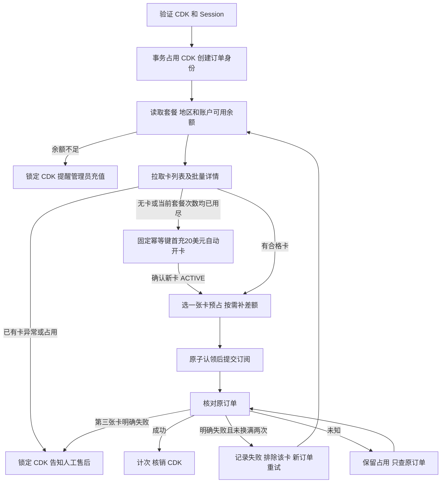

# Orbitcard 充值链路与审计

## 唯一充值入口

用户通过 CDK 提交完整 Session；所有新订阅都调用 Orbitcard 的 `createSubscription`。接单开关关闭、配置缺失或维护中均拒绝新任务，不调用其他支付实现。旧卡池、浏览器、代理、账单地址、支付链接和验证码求解入口已删除。

## 输入和事务

Session 必须是 JSON 对象，包含 `user`、`account`、字符串 `accessToken`（兼容 `access_token`）和有效邮箱；存在 `expires` 时不能过期。凭据真实性由 Orbitcard 校验。系统不进行本地浏览器登录。

先查询卡密已有任务；有订单时恢复原订单，有历史待确认任务时保留人工核对状态。新任务需通过维护、接单配置和并发检查。并发名额在异步创建任务之前占用，避免并发请求突破本机容量。

创建任务的事务先锁定 CDK，检查类型、套餐、是否已用及未结束任务，再创建任务、保存唯一 `client_order_no`、标记 CDK 占用。同一 CDK 的并发请求只能创建一笔新任务。完整 Session 不传给任务写库函数，只在当前请求和工作流内存中使用。地区从 `getSubscriptionPaymentRegions` 按当前套餐读取并核对套餐归属；后台对应套餐设置优先，留空则省略 `payment_region`，由平台选默认地区，不沿用旧全局地区，也不随意取列表第一项。

之后读取卡片及产品目录，同一卡 Plus 4 次、Pro 100/200/500 各 1 次，独立计数且允许混用。选卡通过 MySQL 命名锁串行化：拉取平台卡列表和批量详情，只选 ACTIVE、USD、资料与次数合格且未占用的卡；批量详情缺项时跳过缺失卡，不逐张复核。有剩余次数的卡因异常或占用不可用时锁定 CDK 并提示售后；无卡或当前套餐次数全满时自动开卡，固定首充 20 USD。合格卡不足支付金额时按持久化原补款意图补差额。历史卡必须先确认四项历史次数。详见 [ORBITCARD-CARDS.md](ORBITCARD-CARDS.md)。

## 提交和结果确认

创建订阅之前，在 MySQL 事务中锁定 CDK 和任务，校验固定 `client_order_no` 与当前 `prepared` 状态，只允许一个执行者原子转换到 `submitting`。未认领成功的执行者停止，不能把任务恢复成 `prepared`，也不能调用 `createSubscription`。随后以同一订单身份作为平台幂等键签名。选卡、开卡和补款由现有 MySQL 命名锁及持久化原意图保护，无需新增 Redis 服务。网络超时、HTTP 错误、平台错误码或本地任务超时都不能单独证明没有受理；结果未知时仅查询原订阅订单。

平台详情明确 `subscription_succeeded=false` 或上游订阅状态 `failed`，且返回当前订单的 `client_order_no`、套餐、账号、卡 ID 归属一致时，才把本笔记录为已确认失败。详情若标为快照，或状态与成功标志互相矛盾，则继续保留原单待核对。当前任务与卡片预占在事务中结算，再创建下一笔有新 `client_order_no` 的任务；原订单记录及脱敏审计保留。每笔使用不同卡，明确失败后重新读取平台批量卡片详情并排除已失败卡，最多换两次。三张卡均明确失败后进入 `support_locked`，CDK 保持占用并提示人工售后。请求被拒绝、HTTP 错误、超时、查询失败或平台仅报告本地任务 `failed` 时绝不换身份重试。

重启后若查询确认上一笔失败而仍有次数，下一笔保持 `retry_waiting`，需用户使用同一目标账号重新提交最新 Session；不在数据库持久化完整 Session。重试期间卡准备或补款结果不明时暂停，不能跳过未确认资金操作。后台与用户查询始终定位该 CDK 最新尝试，各笔历史任务可分别审计。

首笔订单明确返回 `submission_outcome=rejected` 时可释放 CDK；后续重试订单被拒绝时转人工售后锁定。其他提交结果不明时保留身份，仅查询 `task_no` 或 `client_order_no`。查询结果先核对订单、套餐及账号归属，再结算。

| 阶段 | 任务 / 订单状态 | CDK |
| --- | --- | --- |
| 已建任务未提交 | `prepared` | 占用 |
| 账户可用余额不足 | `balance_blocked` / `failed` | 锁定；首笔准备阶段可在补足后释放，重试阶段转人工售后 |
| 有剩余次数的卡异常或占用，批量详情无合格卡 | `support_locked` / `failed` | 锁定，提示联系人工售后；不创建订阅订单 |
| 无卡或当前套餐次数全满 | `card_pending` 或继续支付 | 自动开卡首充 20 USD；原申请待确认时保留 CDK 与原幂等键 |
| 卡补款尚待确认，订阅未提交 | `funding_pending` / `manual` | 卡片与 CDK 保持占用，确认原补款后再提示重新提交 Session |
| 可能已发送 | `submitting` | 占用 |
| 等待上游或验证 | `pending` / `running` | 占用 |
| 结果未知或超时 | `manual` | 继续占用 |
| 明确订阅成功 | `success` | 核销 |
| 前两笔明确订阅失败 | 历史任务 `failed`，下一任务 `retry_waiting` / `running` | 占用，换另一张卡尝试 |
| 第三张卡明确订阅失败 | `support_locked` / `failed` | 锁定，转人工售后 |
| 首笔请求被明确拒绝提交 | `rejected` | 释放，需检查资料后重新提交 |
| 后续重试请求被明确拒绝提交 | `support_locked` | 锁定，转人工售后 |

结算事务按同一顺序锁 CDK 和任务，确认当前是该 CDK 最新任务。旧任务不能释放新任务的占用，已确认成功不降级为失败。明确失败后的下一笔自动尝试生成新的订单身份。

同一结算事务继续按卡片、用卡记录顺序加锁：成功仅计次一次并释放该任务的卡占用，明确失败只释放本次预占；未知状态不释放。写卡片计次失败时整个任务/CDK/用卡结算回滚。提交前失败只释放当前任务绑定的卡，不会影响其他任务。

服务费独立于订阅结果。套餐目录只用于判断套餐是否开放；目录 `service_fee` 不用于本地选卡、开卡、补款门槛，也不展示在后台目录。若后台配置 `orbitcard_max_fee`，仅随订阅请求发送 `max_service_fee`，由平台在下单时校验。`payment.amount/currency` 是银行卡支付金额快照；订单中的 `service_fee/currency/fee_status` 是实际平台服务费记录，仍保留用于核对。`charge_failed` 不代表订阅失败，`charge_pending` 继续查询最新收费快照。本项目不把 API 服务费写成虚构的本地卡池账单。

## 查询、验证与重启

用户通过原 CDK 查询，管理员通过原任务查询。自动查询中并发请求合并，连续查询至少间隔 5 秒。任何 Open API 请求遇到 HTTP 429 后，同一根域名和 API Key 的后续请求共享 `Retry-After` 冷却时间；每次请求仍独立生成 HMAC 时间戳、随机数与签名。前台自动跟踪最多 15 分钟，之后可手动查询。

服务启动后恢复持久化的原订单。明确停在 `prepared` 且本机无工作任务的订单可按“从未提交”释放；`submitting/pending/manual` 只查询，不自动再次创建订阅。后台跳过当前前台工作流，失败查询采用退避并轮流处理其他任务。停用新接单不影响已有原单查询，但需保留原平台和有效凭据。

验证码仅使用上游 HTTPS 链接；只在当前响应和内存中保留，前端检查到期时间。后台恢复也不需要保存用户 Session。工作流不进行本地识图、填写银行卡或直接取消续费。

历史非 Orbitcard 运行任务迁移为人工核对，保持卡密占用。不能把这些记录交给 Orbitcard 自动补单，也不能根据旧日志猜测支付失败。

开卡恢复独立于订阅恢复：停在 `prepared` 的开卡意图按未发送处理；`submitting/pending/unknown` 每分钟以原始正文、原 API Key 身份和固定幂等键确认原申请，不切换参数或身份新开卡，并遵守持久化重查时间。等待开卡的充值任务进入 `card_pending` 并保留 CDK，不查询尚不存在的订阅订单。仅有一致订单号且 `status=success`、有效数字卡 ID 才登记新卡。首笔任务在原前台结束或重启后开卡成功会释放 CDK、提示重新提交最新 Session；明确开卡失败也释放 CDK。重试任务遇到这类中断保留 CDK 并转人工售后。恢复本身不自动提交会员充值。

账户余额门槛仅使用 `available_balance`；选卡时卡片状态先于次数和余额筛选，非 ACTIVE 不可选。补款提交前及确认后核对卡片资金；选中支付卡后不再逐张复核。账户不足保持 CDK 与已有卡预占，后台每分钟只读检查，达标后释放并要求最新 Session。恢复任务不会自动提交会员充值。

补款独立于订阅：原意图及请求身份先落库，未知结果进入 `funding_pending`。无订单号时只用原正文和原幂等键确认，有订单号时用 `getCardFlow(type:"recharge")` 按原 `order_no` 精确核对，未查到不能推断失败。平台成功后还需实时卡片 ACTIVE、USD 和余额足够；不因余额同步延迟重复补款。首笔任务后台恢复完成后释放 CDK 并要求最新 Session；重试任务中断则保留 CDK 转人工售后。不查询尚未创建的订阅。每轮限制处理一笔到期补款及一笔到期开卡。

## 日志与权限

| 位置 | 内容 |
| --- | --- |
| `task_logs` | 当前状态、CDK、原订单身份、账号预览、最新安全摘要 |
| `orbitcard_managed_cards` / `orbitcard_card_uses` | 四项独立成功次数、卡占用及每笔任务的预占/结算状态 |
| `orbitcard_card_fundings` | 固定补款身份、原卡/金额、目标余额、订单及费用结果；不覆盖未知订单 |
| `orbitcard_card_issues` | 固定申请身份、产品、首充金额及开卡结果；不删除待确认身份 |
| `data/logs/task-<jobKey>.jsonl` | 按任务保存的请求、响应摘要、状态变化和恢复事件 |
| `data/logs/runtime-YYYY-MM-DD.jsonl` | 按 UTC 日期保存的运行事件 |
| 后台“下载日志” | 管理员认证后下载对应完整任务文件 |

支付前新增 `card_funds_before_subscription` 与 `card_payment_preflight` 资金快照；订阅明确成功后只读复查卡片余额、账户可用余额及首批消费交易数量，写入 `payment_funds_snapshot`。后台“卡片与开卡”可按卡 ID 分页查看脱敏的 `cardTransaction` 记录。交易明细只用于对账，不能仅据此核销 CDK、确认订阅成功或自动退还卡内资金；订阅结论继续以归属核验后的 `getSubscription` 为准。对账接口失败不改变已确认的订阅结论。

实际 HTTP 请求记录开始/结束、耗时、操作、HTTP 状态、平台码、请求结果类型、原订单身份及服务费/支付金额白名单字段。不会写 Session 请求体、API Key、HMAC Secret、签名、验证码凭据或含原始请求的 Axios 错误对象。

CDK 与订单关联记录不提供删除接口；有历史任务或使用记录的 CDK 也不允许删除。CDK 管理要求管理员登录与二级验证。WebSocket 订阅要求对应 CDK 或当前有效管理员令牌。

后台显示缓存有条数限制，磁盘完整 JSONL 独立保留。清空缓存不会删除文件；重启从最近日志末尾恢复显示。磁盘不可写、数据库中断或主机损坏仍需运维介入，不能承诺这些情况下完整保存全部证据。升级前已丢失的日志无法补录。

旧数据库可能仍含历史完整 Session、银行卡等敏感数据；升级不会自动删除或脱敏这些旧记录，备份仍需限制访问。

## 代码与验证

| 模块 | 职责 |
| --- | --- |
| `activation-service.js` | 输入校验、接单门禁、并发名额、创建与调度 |
| `orbitcard-cdk-store.js` | CDK 与原单绑定、事务结算和防止旧任务回滚 |
| `orbitcard-client.js` / `orbitcard-worker.js` | HMAC 请求、只创建一次、原单轮询 |
| `orbitcard-query.js` / `order-recovery.js` | 查询合并、限流、重启恢复 |
| `orbitcard-cards-client.js` / `orbitcard-card-service.js` | 账户可用余额、批量选卡、产品预算、补款及管理员开卡恢复 |
| `orbitcard-money.js` / `orbitcard-funding-service.js` | 十进制差额、幂等补款、原流水恢复和卡余额复核 |
| `orbitcard-card-store.js` / `orbitcard-card-http.js` | 持久化额度和申请、同事务结算、管理员卡片入口 |
| `mysql-core.js` / `mysql-store.js` | 数据库、安全配置、核心表迁移及历史保护 |
| `runtime-log.js` / `log-safety.js` | 持久化审计及敏感字段过滤 |
| `server.js` / `admin-http.js` | 用户与管理员 HTTP、任务订阅 |

`npm test` 使用 Node 内置测试、模拟上游和事务存储，以及本机 HTTP 服务验证流程。不发起真实充值，不能替代部署后的 MySQL 迁移、镜像构建、日志权限或平台连接验证。
