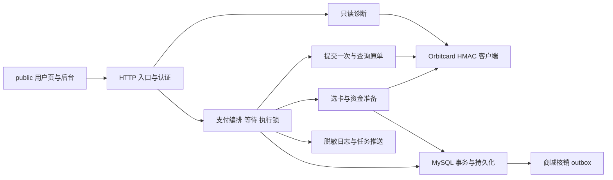

# 架构与开发约定

项目采用 CommonJS、Express 和 MySQL，服务端按职责集中在 `src/`。根目录的 [server.js](../../server.js) 保留兼容启动方式，由 [src/server.js](../../src/server.js) 组装服务、HTTP / WebSocket、后台恢复与停机处理。`npm start`、Docker 入口和原部署目录继续使用。

## 目录与职责

| 目录 | 内容 | 从哪里读起 |
| --- | --- | --- |
| `src/config/` | 环境文件、平台配置、套餐映射 | [load-env.js](../../src/config/load-env.js)、[plan-registry.js](../../src/config/plan-registry.js) |
| `src/http/` | 管理员认证、路由、请求保护 | [admin-http.js](../../src/http/admin-http.js)、[request-guard.js](../../src/http/request-guard.js) |
| `src/payments/` | 自助与管理员订单编排、等待位、执行锁、重试与恢复 | [activation-service.js](../../src/payments/activation-service.js)、[payment-service.js](../../src/payments/payment-service.js)、[order-recovery.js](../../src/payments/order-recovery.js) |
| `src/orbitcard/` | HMAC 客户端、API 契约、选卡、资金、结果与错误分类 | [orbitcard-client.js](../../src/orbitcard/orbitcard-client.js)、[orbitcard-card-service.js](../../src/orbitcard/orbitcard-card-service.js)、[orbitcard-error-policy.js](../../src/orbitcard/orbitcard-error-policy.js) |
| `src/db/` | MySQL 连接、迁移、事务、任务/卡片/订单持久化 | [mysql-store.js](../../src/db/mysql-store.js)、[mysql-transaction.js](../../src/db/mysql-transaction.js) |
| `src/diagnostics/` | 只读接口诊断、支付预检和并发模拟 | [orbitcard-interface-diagnostics.js](../../src/diagnostics/orbitcard-interface-diagnostics.js) |
| `src/integrations/` | 商城核销 outbox 与 Telegram 通知 | [cdk-redemption-webhook.js](../../src/integrations/cdk-redemption-webhook.js) |
| `src/logging/` | 日志脱敏、文件持久化、缓存与保留清理 | [runtime-log.js](../../src/logging/runtime-log.js) |
| `src/realtime/` | 任务 WebSocket 订阅和连接限制 | [task-sockets.js](../../src/realtime/task-sockets.js) |
| `public/` | 原生 HTML / CSS / JavaScript 用户页和后台，无前端构建步骤 | [app.js](../../public/app.js)、[admin.js](../../public/admin.js) |
| `database/` | 新库表结构，启动迁移负责兼容旧库 | [mysql-schema.sql](../../database/mysql-schema.sql) |
| `scripts/` | 安装、结构检查及按需只读平台检查 | [开发验证](../development/TESTING.md) |
| `test/` | Node / Python 测试、事务数据库及平台模拟 | [开发验证](../development/TESTING.md) |

保留模块原文件名，便于按业务名称搜索。根目录保存启动、包管理、部署、许可证和环境模板；运行数据位于 `data/`，临时验证产物放入忽略的 `scratch/`，不作为源代码提交。

## 调用与数据流

自助入口与管理员入口共用选卡、资金准备、订阅校验及错误策略。平台客户端负责通信与安全摘要，数据库模块负责状态归属、互斥及原子结算；HTTP 层组合这些能力。诊断通过读取快照或内存模拟给出结果，不进入正式支付流程。

建议按下列顺序阅读：

1. `src/server.js` 了解依赖组装、API 入口、恢复调度和停机处理。
2. `src/payments/activation-service.js`、`payment-service.js` 与 `orbitcard-manual-service.js` 了解订单受理和每次尝试。
3. `src/orbitcard/orbitcard-payment-decision.js`、`orbitcard-card-service.js` 与 `orbitcard-funding-service.js` 了解可用卡、套餐整额补款和原资金恢复。
4. `src/orbitcard/orbitcard-subscription-service.js`、`orbitcard-query.js` 与 `src/payments/payment-retry-policy.js` 了解原单归属、可信终态与续试边界。
5. `src/db/orbitcard-cdk-store.js`、`orbitcard-manual-store.js` 与 `orbitcard-card-store.js` 了解事务结算和占用释放。

## 修改时必须保持的约束

- 资金意图先落库，写请求使用本次固定身份。网络或 HTTP 错误不证明未扣款；未知订阅仅查原单，已发送补款不得重新 POST，旧资金正文和金额保持原样。
- 新补款按所选套餐完整 USD 金额执行，不扣减卡内余额；卡内已足额则不补款。支付目标仍包含产品最低留存，补款确认后还须验证 ACTIVE、USD 和足额余额，账户不足向前台提示联系客服。
- 同一支付链最多 3 次。确认归属的卡片相关失败才停用并补开；Session、账号、配置或未知原因不能触发自动换卡。卡片计数仅用于统计。
- 外部资金调用在数据库事务之外。只对确认回滚的数据库死锁/等待超时有限重试；保持原锁顺序，状态释放前重新核对订单与未决资金。
- Session 只保留必要的工作流内存，日志与响应使用白名单摘要。完整卡号、CVV、密钥和原始 Axios 错误不得进入日志。
- 新增平台操作先更新 API 契约和对应归属/错误校验；诊断不得以模拟通过替代真实支付授权。
- 运行资源路径锚定项目目录或明确配置，不能依赖调用方的当前目录。移动模块时同时更新 `require`、测试、Docker/Compose、脚本与文档链接。

详细状态、锁和恢复条件见[充值链路与审计](RECHARGE-AUDIT.md)，故障码和管理员措施见[卡池规则](../operations/ORBITCARD-CARDS.md)。修改后执行[开发验证](../development/TESTING.md)中的检查；数据库结构或资金行为变更要补充对应业务回归，不以快照文案测试代替业务验证。
