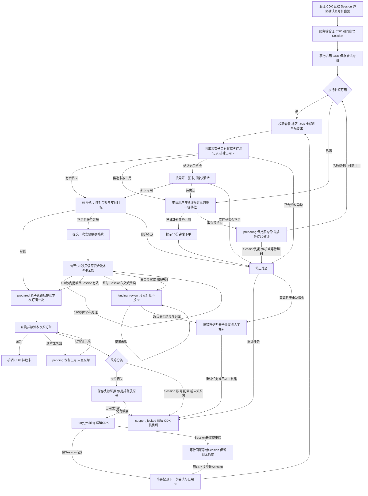

# Orbitcard 充值链路与审计

## 整体流程与阅读顺序

主链路是：**确认目标账号和套餐 → 受理并占用 CDK → 选择并预占现有卡 → 必要时按套餐全额补款 → 提交本次订阅一次 → 查询原单 → 事务结算 → 成功弹窗**。自助兑换与管理员开通使用同一选卡和结果判断，管理员真实测试不消耗 CDK。

| 层次 | 入口及主要代码 | 负责的事情 |
| --- | --- | --- |
| 用户交互 | public/app.js → src/server.js | CDK 验证、Session 账号确认、提交和查单；成功弹窗显示原订单账号和套餐 |
| 受理与编排 | src/payments/activation-service.js、src/payments/payment-service.js；管理员为 src/payments/orbitcard-manual-service.js | 配置门禁、执行锁、等待位、尝试身份和最多三次尝试 |
| 选卡与资金 | src/orbitcard/orbitcard-card-service.js → src/orbitcard/orbitcard-payment-decision.js、src/orbitcard/orbitcard-funding-service.js | 实时资料与余额、本地停用、事务预占、原补款恢复 |
| 订阅与查询 | src/payments/orbitcard-worker.js、src/orbitcard/orbitcard-subscription-service.js、src/orbitcard/orbitcard-query.js | 原子认领、单次提交、归属校验、成功／失败／未知结果判断 |
| 结算与计数 | src/db/orbitcard-cdk-store.js／src/db/orbitcard-manual-store.js → src/db/orbitcard-order-usage.js | 同一事务内核销、写成功订单账本、去重计数、释放卡片 |
| 后台恢复与同步 | src/payments/order-recovery.js、src/orbitcard/orbitcard-card-service.js、src/server.js 定时任务 | 查待确认的原订阅和原资金，刷新卡片信息 |
| 独立对账与诊断 | src/orbitcard/orbitcard-authorizations.js、src/diagnostics/orbitcard-diagnostics.js、src/diagnostics/orbitcard-concurrency-simulation.js | 授权流水对账；只读预检和选卡模拟，不替代会员订单成功证据 |

用户确认只存在当前页面内存中；修改 CDK 或 Session 后必须重新确认。提交后以及刷新页面查单时，成功弹窗的账号、套餐均取自原订单，不能从当前输入框推断。Session 不写数据库、日志或浏览器持久存储。

需要区分三种数据：**本地任务状态**决定任务如何恢复；**卡台订阅结果**决定是否计入成功订单；**消费授权流水**仅用于对账。已确认成功的原单在结算事务中记入本地账本。

以下依次展开受理、等待、提交结算、重启恢复和审计。卡片细节见 [ORBITCARD-CARDS.md](../operations/ORBITCARD-CARDS.md)，服务器更新见 [DEPLOY.md](../operations/DEPLOY.md)。

## 唯一充值入口

用户通过 CDK 提交完整 Session；所有新订阅都调用 Orbitcard 的 `createSubscription`。接单开关关闭、配置缺失或维护中均拒绝新任务，不调用其他支付实现。旧卡池、浏览器、代理、账单地址、支付链接和验证码求解入口已删除。

`src/orbitcard/orbitcard-api-contract.js` 按 Open API 和订阅 API 限制出站操作名与顶层字段，校验定点金额字符串及写操作幂等键；订单归属与原请求恢复仍由业务层处理。清理旧兼容入口和冗余展示不改变 CDK、订阅、资金及历史任务的状态规则。

## 输入和事务

Session 必须是 JSON 对象，包含 `user`、`account`、字符串 `accessToken`（兼容 `access_token`）和有效邮箱；存在 `expires` 时不能过期。凭据真实性由 Orbitcard 校验。系统不进行本地浏览器登录。

先查询卡密已有任务；有订单时恢复原单，历史待确认任务保留人工核对。新任务需通过维护与接单配置校验，并认领执行名额或唯一共享等待位；并发名额满不直接创建并行支付。用户兑换、管理员真实测试和人工交付共用固定 MySQL 命名锁保护的一个等待位，已满时弹窗提示 10 分钟后下单；同一原请求重复查询不会另占等待位。

在任务创建前取得按 CDK 归一化标识生成的 MySQL 命名执行锁，直到后台支付完成或转入待确认才释放。管理员订单按请求编号取得执行锁；人工交付额外取得同一 CDK 锁。所有锁按稳定顺序申请，抢占失败不进入选卡或资金准备。恢复任务和手动查单使用相同执行锁，并在取得锁后重新读取最新状态。锁连接独立于业务连接池，结束或异常时断开连接释放锁，避免复用连接遗留所有权。

只含数据库操作的事务遇到 MySQL 1213 死锁或 1205 锁等待超时，在回滚成功后最多尝试 3 次并短暂随机退避。提交结果不明或回滚失败不重放，失败连接不返回连接池。开卡、补款和订阅接口调用不在这个数据库重试机制中。

写入补款意图时在同一事务重新锁定订单和卡片，检查任务状态及卡片归属。释放准备中的 CDK 时，再次锁定并检查未结束的开卡/补款意图，避免恢复任务用较早的无意图快照误释放。旧失败/拒绝终态不可被迟到查询重新打开；平台订单号一旦绑定，其他订单号不能覆盖。管理员未提交的准备单也不能直接结算。

创建任务的事务先锁定 CDK，检查类型、套餐、是否已用及未结束任务，再创建 `preparing` 任务，保存唯一 `client_order_no` 并占用 CDK；并发请求只能创建一笔。Session 不传给写库函数，只留在请求和工作流内存。四档默认地区保存于 `orbitcard_payment_regions`：「平台默认」省略 `payment_region`；指定地区在选卡及补款前调用 `getSubscriptionPaymentRegions` 校验，失败或失效时停止，不回退。用户兑换和管理员开通共用该逻辑。已提交订单只查原单，修改地区不触发重提。

后台通过 `getProductCode` 提供开卡渠道（product_code）和 BIN 多选，保存于 `orbitcard_product_codes` 与 `orbitcard_bins`。选卡和事务预占检查独立的 `disabled_*` 停用记录。成功订单计数用于每卡累计三次上限；满额后停用旧卡。实际支付预选无合格现有卡时按需补开一张。明确卡片相关错误与原订单结算、卡片释放在同一事务内登记停用，自动补开按原卡和失败任务身份唯一保存。人工停用与恢复需要二级验证、修改原因及管理员审计。

之后读取 `orbitcard_plan_prices` 套餐 USD 金额，缺配置时停止，不从历史订单或 USDT 服务费推测。MySQL 命名锁保护同步和选卡，只选 ACTIVE、USD、资料完整、无本地停用标记、未占用的现有卡，重试排除此前用过的卡，优先使用现有健康卡，不因开卡渠道或库存失败阻断；现有卡选择不查询开卡产品目录。卡内足额准备订阅；不足时按本次套餐完整 USD 金额（向上取到分）补款，不扣减卡内余额，不叠加开卡产品最低留存。只有本次补款后满足套餐 USD 金额，且账户 `available_balance` 足够时才保存意图并提交；否则提示联系客服，不发起资金请求。首笔准备失败安全释放无未决资金占用，重试准备失败保留 CDK 售后锁定。明确卡片错误停用后，缺少合格现有卡的实际支付可以按需补开，管理员仍可手动申请。卡片释放后按停用记录、实时状态、余额和未决资金决定能否复用，冻结闲卡排除；消费授权延迟不阻塞选卡。后台刷新卡片资料并维护原退役记录。自动补开仅在实际支付准备时按唯一原申请处理。成功会员订单按唯一订单号去重，授权流水只作独立对账。详见 [ORBITCARD-CARDS.md](../operations/ORBITCARD-CARDS.md)。

## 共享等待与恢复

支付并发名额已满，或其余条件合格的现有卡被占用时，进入用户与管理员共用的等待协调器。全局最多一个等待任务，固定 MySQL 命名锁保证唯一；等待期间保留原 CDK、管理员 `request_id` 和本次尝试身份，沿用 `preparing` 状态及等待消息，不新增任务状态或支付尝试。内部仍保留当前执行记录，避免后台恢复误释放；对外 `active_foreground_jobs` 扣除等待者，另返回 `waiting_jobs` 与 `max_waiting_jobs=1`。

共享等待最长 30 分钟。上一任务释放卡片后，本地停用标记、平台状态、余额和未决资金校验全部满足，才进入分配锁与事务预占，并自动继续原等待任务。固定 5 分钟卡片冷却已取消，运行流程不再读写 `reuse_after_ms`。前单结果未知时不复用卡，不允许同卡并行占用；等待本身不发起开卡，已有错误补开可在同一等待位确认。库存为空、卡资料异常、未决资金仍按原失败或对账规则处理；等待位已满提示 10 分钟后下单。

等待 Session 只保留在工作流内存，按其自身 `expires` 与总等待截止检查；独立于管理员失败续试的 15 分钟内存缓存。Session 到期、进程停机或等待超时后，先事务核对原身份及未决资金：首笔尚未付款且无未决资金时安全释放卡片和 CDK；已经失败后进入重试的 CDK 保持售后锁定。进程重启复用原 `preparing` 恢复规则，不恢复丢失的 Session 或新建替代付款。数据库锁随连接关闭释放；释放等待位不等于可以释放结果未知的资金或订阅。此功能不新增数据库字段、环境变量或外部服务，运行仍要求单应用实例。

## 提交和结果确认

卡片与资金就绪后，任务从 `preparing` 或 `funding_waiting` 转为 `prepared`。每次尝试提交前，在事务中锁定 CDK 和任务，校验该次固定 `client_order_no` 与 `prepared` 状态，仅允许一个执行者认领 `submitting`；未认领成功不得调用 `createSubscription`，也不能恢复为 `prepared`。以同一尝试身份作为平台幂等键签名。选卡及资金准备由命名锁和持久化原意图保护，无需 Redis。网络超时、HTTP 错误、平台错误码或本地超时不能单独证明未受理，未知结果保持 `pending`，只查原订阅，不自动转人工或换卡。

平台详情明确 `subscription_succeeded=false` 或上游订阅状态 `failed`，且当前订单号、套餐、账号、卡 ID 等归属一致时，才记录已确认失败。来源不明的快照或状态与成功标志矛盾时继续查原单；仅当 `query_source=snapshot`、`result_source=upstream` 且三个终态字段明确一致时，才接受上游终态快照。自助和管理员订单确认失败后，先按统一错误策略分类：明确卡片相关错误在同一事务保存脱敏原因、持久化停用并释放本次卡，CDK 保持占用；仍有额度时进入 `retry_waiting`，按规则补开并选择未用过的卡，总计最多 3 次。Session、账号、配置或未知原因的已确认终态失败进入 `support_locked`，不自动停卡或支付下一次。无可等待的合格现有卡、等待失败、重试准备失败或次数耗尽才进入 `support_locked`。HTTP 错误、超时、查询失败、服务费失败及本地任务 `failed` 均不单独构成换卡依据；资金异常或未决也不能换卡。

自助重试复用已有 `orbitcard_retry_root_job_key`、`orbitcard_retry_attempt_no`、前两张卡 ID 字段及子任务：事务内确认本任务仍是 CDK 最新任务、失败证据与身份一致，才创建下一次 `preparing` 子任务，旧任务保留失败结果。管理员保持原 `request_id`，更新本次 `client_order_no`，把旧失败订单身份、卡片与安全摘要追加到 `retry_history MEDIUMTEXT`；该列由启动迁移补齐。次数和已用卡持久化，选卡及最终预占均排除已用卡，重启或重复提交不重置额度。

Session 只保留内存，不写数据库、浏览器存储或日志。管理员最多保留 64 份、15 分钟，并检查 Session 自身有效期。原 Session 有效时可自动续试；失效、丢失或重启后保持 `retry_waiting`，要求原 CDK 或原管理员 `request_id` 与同账号新 Session，经原平台及 API Key 身份校验后继续剩余额度。无可核验失败证据的历史 `retry_waiting` 不自动付款，保留售后；普通 `manual` 和已售后锁定任务不恢复。

首笔订单可信地明确拒绝且不是可分类的卡片拒绝时进入 `rejected`，无未决资金才释放 CDK 与支付卡；可信的创建 `59005` 按卡片错误停用、补开和额度处理，无上游订单号也须保存与本次身份绑定的拒绝证据。重试中非卡片拒绝或准备失败保留 CDK 供售后。其他提交结果不明保持 `pending`，仅查询原 `task_no` 或 `client_order_no`。查询先核对订单、套餐及账号归属，再结算；历史 `manual` 保留人工状态。

| 阶段 | 任务 / 订单状态 | CDK |
| --- | --- | --- |
| 已建任务，正在准备卡片和资金 | `preparing` / `running` | 占用；兼容读取旧 `prepared` 准备记录 |
| 并发名额满，或候选现有卡占用 | `preparing`，附等待原因 | 共用唯一等待位，最多 30 分钟；原身份不变，不付款或开卡 |
| 共享等待位已满 | 拒绝新增等待并提示 10 分钟后下单 | 不抢占其他任务的卡片；已有请求仍查原单 |
| 等待超时、Session 到期或停机 | 按原准备任务安全收尾 | 首笔未付款且无未决资金时释放；支付重试 CDK 保持售后锁定 |
| 卡片和资金已就绪，尚未提交 | `prepared` / `running` | 占用；可原子认领一次订阅提交 |
| 新任务账户可用余额不足本次套餐补款金额 | `rejected` / `failed` | 提示联系客服；释放没有未决资金操作的 CDK 与卡片，不发起补款 |
| 历史账户余额锁定任务 | `balance_blocked` / `failed` | 保留原恢复逻辑；新任务不进入此状态 |
| 已核验的订阅出现卡片相关错误 | 持久化停用并登记补开 | 按原卡及失败任务唯一开卡，保留固定幂等身份 |
| 只有占用中的候选卡 | 申请共享等待位 | 有等待位时保留原任务，卡真正可用才继续；已满提示 10 分钟后下单 |
| 本地成功次数无效 | 提示核对卡片记录 | 跳过该卡，其他卡仍按实时状态、停用、占用和余额筛选 |
| 卡片已释放，仅新增授权仍未同步 | 可按正常条件复用 | 以本地停用标记、实时余额、状态和占用决定，不等待消费授权同步 |
| 准备记录临时无法读取 | `preparing` 或旧 `prepared` / `manual` | 保留 CDK 与支付卡，不查询尚未创建的订阅 |
| 批量详情整体缺失或归属异常 | `support_locked` / `failed` | 锁定，提示联系人工售后；不盲目开卡 |
| 实际支付预选确认缺卡 | 确认原补开申请或登记唯一补开 | 库存、余额与产品条件不满足时保留记录供核对 |
| 已知原补款处理中或余额延迟，订阅未提交 | `funding_waiting` / `running` | 每至少 5 秒只读对账，遵守更长 Retry-After；120 秒内到账足额且 Session 有效时继续原订阅 |
| 补款等待超时、Session 失效或进程重启 | `funding_review` / `manual` | 人工对账工单；后台仅查原资金号，确认 `ready` 或 `failed` 后安全收尾；首笔普通 CDK 释放并要求新 Session，重试 CDK 保持锁定 |
| 补款身份、金额或卡片资料异常 | `funding_pending` / `manual` | 保留原身份；有原订单号时继续只读核对，校验通过且资金终态明确后安全释放，不自动恢复付款 |
| 开卡待确认 | `card_pending` / `manual` | 有原订单号时以原正文和幂等键确认；未发送意图可失败，无订单号的未知申请不重放；确认后安全收尾 |
| 可能已发送 | `submitting` | 占用 |
| 等待上游或验证 | `pending` / `running` | 占用 |
| 原订单返回上游终态快照 | `success`、`retry_waiting` 或 `support_locked` | 归属匹配，`query_source=snapshot`、`result_source=upstream` 且 `status`/`upstream_status`/`subscription_succeeded` 三项明确一致时正常结算；失败是否重试还须命中卡片相关分类并满足剩余额度与安全条件 |
| 已提交订阅结果未知或超时 | `pending` / `running` | 继续占用，后台查询原单，不自动转人工 |
| 历史人工订阅任务 | `manual` | 保留人工状态，仅核对原单，不恢复付款 |
| 明确订阅成功 | `success` | 核销 |
| 已确认的卡片相关订阅失败 | `retry_waiting` / `running`，或 `support_locked` / `failed` | 保留 CDK，停用并释放原卡。下一次支付预选缺卡时登记补开，最多 3 次支付，准备失败或额度耗尽转售后 |
| 已确认的 Session / 账号 / 配置 / 未知原因失败 | `support_locked` / `failed` | 不自动停卡或继续支付，保留 CDK 供人工核对 |
| 首笔可信的非卡片创建拒绝 | `rejected` | 无未决资金才释放，修复原因后重新提交；可信 59005 按卡片失败处理 |
| 等待重试但 Session 不可用 | `retry_waiting` | 保留额度和占用，用原账号新 Session 续跑；缺少可核验失败证据的旧记录转售后，不付款 |

结算事务按同一顺序锁 CDK 和任务，确认当前是该 CDK 最新任务。旧任务不能释放新任务占用，已确认成功不降级为失败。只有已确认卡片相关订阅失败（含可信创建 59005 拒绝）且具备剩余额度、同账号及原平台身份、无未决资金操作时，才可事务认领下一次尝试；历史失败身份不被覆盖或重新提交。

同一结算事务按卡片、用卡记录顺序加锁。只有归属匹配且卡台明确成功的原订单回执才写入成功订单账本并增加计数，随后释放本次占用；本地成功标记或人工核销不计数。重复原订单通过唯一约束去重，任何写入失败均回滚计数、任务、CDK 与卡片状态。未知订阅仍保留占用；授权同步和旧冷却字段不阻止明确终态后的正常复用。

服务费独立于订阅结果。套餐目录只用于判断套餐是否开放；目录 `service_fee` 不用于本地选卡、开卡、补款门槛，也不展示在后台目录。若后台配置 `orbitcard_max_fee`，仅随订阅请求发送 `max_service_fee`，由平台在下单时校验。`payment.amount/currency` 是银行卡支付金额快照；订单中的 `service_fee/currency/fee_status` 是实际平台服务费记录，仍保留用于核对。`charge_failed` 不代表订阅失败，`charge_pending` 继续查询最新收费快照。本项目不把 API 服务费写成虚构的本地卡池账单。

## 查询、验证与重启

用户通过原 CDK 查询，管理员通过原任务查询。自动查询中并发请求合并，连续查询至少间隔 5 秒。任何 Open API 请求遇到 HTTP 429 后，同一根域名和 API Key 的后续请求共享 `Retry-After` 限流等待时间；每次请求仍独立生成 HMAC 时间戳、随机数与签名。前台自动跟踪最多 15 分钟，之后可手动查询。

服务启动后恢复持久化原订单。共享等待不保存 Session，停在 `preparing` 的等待任务沿用原准备恢复规则；首笔未提交且无未决资金时安全释放，支付重试 CDK 保持售后锁定。运行中的等待任务仍在当前执行集合内，后台不将它误判为中断。其他首笔 `preparing` 或历史 `prepared` 未提交任务无未决资金时也可安全释放；自助重试准备中断保留 CDK 供售后；管理员第 2、3 次尚在普通准备阶段时，用原请求与同账号新 Session 继续仍沿用当前尝试身份，不重置次数。有原补款号且仍为 `pending`，或停在 `funding_waiting` 时转 `funding_review`，不能用丢失的 Session 续订。`funding_review`、有订单号的 `funding_pending` 只读对账，`card_pending` 按下述原开卡规则确认；资金确认后只安全收尾，不自动付款。`support_locked` 和普通 `manual` 不恢复；`submitting/pending` 与历史人工订阅继续查原单，绝不重发本次订阅。确认卡片相关失败且尚有额度时可转 `retry_waiting`，重启后须原账号新 Session 继续剩余额度。后台跳过前台工作流，失败查询退避；停用新接单或人工核销不阻断原资金核对，但须原平台及有效凭据。

验证码仅使用上游 HTTPS 链接；只在当前响应和内存中保留，前端检查到期时间。后台恢复也不需要保存用户 Session。工作流不进行本地识图、填写银行卡或直接取消续费。

历史非 Orbitcard 运行任务迁移为人工核对，保持卡密占用。不能把这些记录交给 Orbitcard 自动补单，也不能根据旧日志猜测支付失败。

开卡确认独立于订阅恢复。后台可在本地结束未提交的普通 `prepared` 开卡意图。已有补开申请在实际支付预选缺卡时继续确认，也可由管理员主动确认。历史 `card_pending` 对应的申请由管理员在取得原平台 `order_no` 后，按原正文、API Key 和幂等键确认。确认遵守持久化重查时间。等待开卡的充值任务保留 CDK。仅有一致订单号、`status=success` 和有效数字卡 ID 时登记新卡。本地开卡记录已确认 `ready` 或 `failed`，并在事务中验证原申请、卡片归属及无其他未决操作后，`card_pending` 任务可安全收尾。普通 CDK 释放后要求最新 Session，人工核销及支付重试的 CDK 保持锁定。资源收尾不依赖消费授权同步。

账户余额门槛仅使用 `available_balance`，只在卡内不足时与本次套餐补款金额比较，不扣除其他卡片余额；首笔不足时提示联系客服，并释放没有未决资金操作的未提交任务，重试准备失败保持 CDK 售后锁定。选卡检查卡片实时状态、停用记录、占用和余额，同时检查成功次数少于 3 次，非 ACTIVE 不可选。补款提交前及确认后核对卡片资金，每至少 5 秒只读查询原流水与余额，更长 `Retry-After` 优先；原 Session 续跑等待最多 120 秒。已知原资金订单仍处理中、查询临时失败或余额未同步时保留等待，在两次核对之间释放全局卡分配锁。窗口内原任务执行锁与卡片占用保留，不能把尚未确认的资金转给其他任务；其他卡的分配不受这段等待锁阻塞，任务仍计入并发容量。卡片资料异常则停止自动处理并保留人工核对。

补款独立于订阅：原意图及请求身份先落库。有订单号时用 `getCardFlow(type:"recharge")` 按原 `order_no` 精确核对，未查到不能推断失败。异步对账绝不调用 `rechargeCard`；缺少原平台订单号、金额/身份不匹配或无效卡资料时转人工，不凭余额变化认领资金结果。平台成功后还需实时卡片 ACTIVE、USD 和余额足够。

补款延迟期间，自助与管理员仅在 120 秒窗口内用原内存 Session 续跑；到账足额且 Session 有效后原子认领本次订阅一次。超时、Session 失效或重启转 `funding_review`，后台只读原资金号，不重新补款或换卡。带原订单号的 `funding_pending` 也可只读核对，身份、金额异常须校验通过；补款成功且卡片 ACTIVE、USD、余额足额才记 `ready`。确认 `ready` 或明确 `failed` 后，事务复核归属及无其他未决操作，再释放未提交卡片和普通首笔 CDK，要求最新 Session（管理员首笔需新请求编号）。已人工核销及支付重试 CDK 保持锁定，资金收尾不依赖授权同步；未知资金不能仅因超时释放。此资金恢复复用原资金表与状态；管理员换卡历史另新增 `retry_history` 列，无新增环境变量。历史 `balance_blocked` 仍按原规则恢复，新任务账户不足时提示联系客服并按原准备规则安全收尾。

## 日志与权限

后台所有订单均提供“人工修改”入口，可追加备注、暂停自动处理或登记人工交付完成／人工确认失败。人工结果通过 `manual_result` 及原因、管理员、时间独立保存，不再要求先结束原资金才能登记已通过其他卡完成的交付。修改前仍取得执行锁，并在事务内核对当前任务、卡片归属及原开卡、补款、订阅证据；是否允许正常资金结算通过 `settlement.allowed` 单独返回。例如 `manual / funding_pending` 登记人工交付成功后，业务订单已关闭，原资金核对状态不会因此结束。`business_status=closed`、`business_result` 和 `business_closed_at` 直接由已有人工结果派生，旧记录自动生效，无需改写资金状态；备注和暂停不产生闭单。

登记成功或失败时，可明确设置布尔 `release_local_hold: true` 解除原订单本地占用；`release.allowed` 根据原资金与卡片实际占用归属决定，不能解除其他订单的占用。默认 `false` 时，未决占用继续保留，已完成核对的卡片占用按正常结案规则处理；人工失败的未核销 CDK 只有在明确选择释放时才解除售后锁定，成功或已核销 CDK 不撤销核销。本地释放保存时间、管理员和原因，并将 `release_local_hold` 写入同一事务的追加审计。它不改变原资金状态、不退款、不撤销卡台请求，原扣款仍可能完成，原记录继续核对。

订单列表与人工处理弹窗主状态显示业务已关闭，原平台／资金状态置于折叠核对记录，本地释放标记独立展示。概览成功／失败按人工结果优先计数，人工终态不再计入处理中／待确认；核对原记录不重新打开业务订单，也不提供继续准备、重试或验证码入口。人工标记不会伪造平台回执、增加卡片成功次数或触发充值成功邮件，也不会重新启用自动支付。历史及非最新订单仍可追加备注，不能修改后续任务的结果。完整规则见[订单人工处理](../operations/ORDER-MANUAL-CONTROL.md)。

| 位置 | 内容 |
| --- | --- |
| `task_logs` | 各次状态、CDK、根任务与重试序号、已用卡、原订单身份、账号预览和安全摘要 |
| `orbitcard_admin_orders.retry_history` | 管理员旧失败尝试的订单身份、卡片及安全结果；Session 不落库 |
| `orbitcard_managed_cards` / `orbitcard_successful_orders` / `orbitcard_card_authorizations` / `orbitcard_card_uses` | 卡台成功会员订单次数及独立授权 ID、卡片占用及每次尝试的预占/结算状态 |
| `orbitcard_card_fundings` | 固定补款身份、原卡/金额、目标余额、订单及费用结果；不覆盖未知订单 |
| `orbitcard_card_issues` | 固定申请身份、产品、首充金额及开卡结果；不删除待确认身份 |
| `TASK_LOG_DIR/YYYY-MM-DD/task-<jobKey>.jsonl` | 按北京时间日期和任务保存的请求、响应摘要、状态变化及恢复事件 |
| `TASK_LOG_DIR/runtime-YYYY-MM-DD.jsonl` | 按北京时间日期保存的运行事件 |
| 后台“下载日志” | 管理员认证后下载对应完整任务文件 |

支付前记录 card_funds_before_subscription 与 card_payment_preflight，成功后只读复查资金快照。卡片复用按本地停用、实时状态、占用及资金判断，成功会员订单数达到 3 次即停止分配；第三次成功结算时持久化停用标记。后续实际支付缺少合格现有卡时按需补开一张，未完成申请沿用原身份。原单通过 getSubscription 返回的结果和归属确认后再结算。授权流水保留独立对账，不改变会员订单次数、不核销 CDK；对账失败不改变已确认的订阅结论。

实际 HTTP 请求记录开始/结束、耗时、操作、HTTP 状态、平台码、请求结果类型、原订单身份及服务费/支付金额白名单字段。不会写 Session 请求体、API Key、HMAC Secret、签名、验证码凭据或含原始请求的 Axios 错误对象。

CDK 与订单关联记录不提供删除接口；有历史任务或使用记录的 CDK 也不允许删除。CDK 管理要求管理员登录与二级验证。WebSocket 订阅要求对应 CDK 或当前有效管理员令牌。

后台显示缓存有条数与容量限制，完整 JSONL 独立写磁盘；清空缓存不删除文件，重启从最近日志末尾恢复显示。运行与任务日志按北京时间日期保留当天及前 14 天，每日零点清理，启动补清理；默认路径为 Linux `/var/log/pay-gpt-orbit` 或 Windows 系统盘 `ProgramData/Pay-gpt-Orbit/logs`，可用 `TASK_LOG_DIR` 配置，Compose 宿主目录用 `APP_LOG_DIR`。磁盘不可写、数据库中断或主机损坏仍需运维，升级前丢失日志无法补录。详见 [日志存储与迁移](../operations/DEPLOY.md#环境更新与存储)。

旧数据库可能仍含历史完整 Session、银行卡等敏感数据；升级不会自动删除或脱敏这些旧记录，备份仍需限制访问。

## 代码与验证

| 模块 | 职责 |
| --- | --- |
| `src/payments/activation-service.js` | 输入校验、接单门禁、并发名额、创建与调度 |
| `src/payments/payment-waiting-queue.js` | 用户与管理员共享唯一等待位、并发与卡片等待、30 分钟截止及队满反馈 |
| `src/payments/payment-execution-lock.js` / `src/db/mysql-transaction.js` | 跨进程执行互斥、连接失效检查、仅数据库事务的有界冲突重试 |
| `src/config/plan-registry.js` | 四档本地套餐、平台套餐映射及历史套餐别名 |
| `src/payments/payment-service.js` / `src/payments/payment-retry-policy.js` | 自助尝试编排、确认失败判定、次数上限、已用卡排除及结算通知 |
| `src/db/orbitcard-cdk-store.js` | CDK 与原单绑定、事务结算和防止旧任务回滚 |
| `src/orbitcard/orbitcard-client.js` | HMAC 请求、超时和平台限流、响应安全摘要 |
| `src/orbitcard/orbitcard-subscription-service.js` | 自助、管理员和恢复共用的参数校验、下单正文、原单归属与结果判定 |
| `src/payments/orbitcard-worker.js` | 单次订阅尝试、持久化认领、提交一次和原单轮询 |
| `src/orbitcard/orbitcard-query.js` / `src/payments/order-recovery.js` | 查询合并、限流、重启恢复 |
| `src/orbitcard/orbitcard-payment-decision.js` | 对现有卡快照作出支付、补款、等待或拒绝决策，不包含网络或数据库操作，也不自动开卡 |
| `src/orbitcard/orbitcard-cards-client.js` / `src/orbitcard/orbitcard-card-service.js` | 账户可用余额、批量选卡、配置的 USD 支付预算、补款及管理员开卡恢复 |
| `src/payments/orbitcard-manual-service.js` / `src/db/orbitcard-manual-store.js` | 测试及人工交付、并发占位、失败历史、Session 内存续试与原单恢复 |
| `src/orbitcard/orbitcard-money.js` / `src/orbitcard/orbitcard-funding-service.js` | 十进制定点金额、幂等补款、原流水恢复和卡余额复核 |
| `src/db/orbitcard-card-store.js` / `src/http/orbitcard-card-http.js` | 持久化卡台成功订单与独立授权 ID、计数和申请，同事务预占结算及管理员卡片入口 |
| `src/db/mysql-core.js` / `src/db/mysql-store.js` | 数据库、安全配置、核心表迁移及历史保护 |
| `src/logging/runtime-log.js` / `src/logging/log-safety.js` | 持久化审计及敏感字段过滤 |
| `src/server.js` / `src/http/admin-http.js` | 用户与管理员 HTTP、任务订阅 |

`npm test` 使用 Node 内置测试、模拟上游和事务存储，以及本机 HTTP 服务验证流程。不发起真实充值，不能替代部署后的 MySQL 迁移、镜像构建、日志权限或平台连接验证。

支付流程独立于 HTTP：先校验 Session、套餐和订单编号，再准备现有卡及资金，原资金优先对账，每次原子认领后只提交一次。换卡必须有归属一致的确认卡片相关失败证据（含可信创建 59005 拒绝），最多追加两次不同现有卡尝试；自助子任务和管理员 retry_history 保留各笔旧失败身份。原 API Key 指纹必须匹配，管理员还须匹配原平台；缓存不能绕过校验。尚在准备的管理员订单不查订阅，提交后刷新遵守间隔。有效 `retry_waiting` 可用同账号新 Session 继续剩余额度，缺少证据的历史记录不能自动付款。

## 调试与日志

「调试与日志」统一入口含「接口查询」「支付预检与测试」「订单链路」「运行日志」「登录记录」。管理员订单列表归入「订单链路」，显示第 N / 3 次和历史卡片日志，订单行保留快捷入口；「手动开通」只留人工交付，真实测试唯一入口在「支付预检与测试」，旧 `#logs` 自动进入运行日志。Telegram 发送测试位于「接口查询」的独立通知面板，使用已保存通知配置真实发送消息，设置页保留快捷入口；卡台查询面板仍只读。

只读预检用独立 debug 编号串联阶段，按持久化停用标记和实时平台状态复用正式选卡纯判断，不分配、不预占、不写同步状态，也不开卡、补款或创建订阅。并发模拟共用模拟占用及预算，最多 1 个任务等待，其余需要等待的任务标记 `blocked / queue_full`；不模拟任务完成后释放卡片。真实测试复用管理员订单的原子认领、最多三次现有卡尝试及原单恢复。读取套餐前绑定 auditJobKey，使地区、账户、产品、卡片、补款及订阅事件写入对应任务链路；手动申请和历史开卡恢复保留各自审计身份。Session 校验、参数及归属核对日志共用脱敏规则。

预检只报告现有卡选择、补款、等待及满额卡片；已删除固定返回 null/false/0 的 `capacity_limit`、`auto_refill`、`open_count`、`opening_amount`，并发统计删除始终为零的 `summary.opening`。独立产品预览按钮已删除；`GET /api/admin/orbitcard/products` 供配置页读取真实开卡渠道及 BIN 多选目录，手动开卡、错误补开和产品接口查询按需读取产品，现有卡支付准备与只读预检不请求产品目录。手动申请及历史原订单的开卡、补款核对仍有独立持久化身份，错误补开同样保存原申请和失败来源用于审计。

日志读取接口要求二级验证，按文件字节游标分页，校验任务名和换行边界，不允许路径穿越。读取现有日志时再次脱敏，支持清空缓存或进程重启后继续查看；不伪造升级前不存在的步骤记录。产品推荐价依赖已移除，后台配置每档 USD 卡支付金额，根据实时余额与套餐 USD 金额判断是否补款，需要时使用配置的套餐完整 USD 金额。

## 卡片管理操作与刷新

手动开卡直接进入原申请核对或新申请准备：读取产品、校验首充与账户余额、保存原申请身份、提交并确认结果。无需先执行产品预览。现有卡支付仅按本次实时余额与套餐金额判断是否需要整额补款，不受开卡渠道、BIN、产品库存、最低首充或最低留存限制；已用卡仍从重试候选中排除，不跨订单缓存余额。已持久化资金意图继续按原 `target_balance`、金额、正文和幂等键核对。

卡片页面将操作结果与本地列表刷新分开：已确认开卡成功后，列表刷新失败只提示刷新本地记录；开卡未确认时保留原错误与原申请查询提示，后续刷新异常不能覆盖原错误。同步已返回结果但本地列表读取失败时同样保留同步结果，不误报平台同步失败，也不自动重复提交。

## 历史兼容与统计

删除未被业务调用的授权 ID 列表方法、授权写入后的无用回读、旧授权基线写入、授权等待字段的建表／补列，以及选卡结果中无人读取的价格副本。卡片可用性由 `orbitcard-pool.eligible` 检查本地停用标记、历史退役记录及成功订单上限。历史 `orbitcard_max_authorizations` 停止参与业务判断。卡片错误补开与人工修改规则见 [卡片规则](../operations/ORBITCARD-CARDS.md)。

新安装不创建 `authorization_pending_count` 和 `authorization_baseline`；升级不删除旧列或历史订单数据。历史开卡、补款、原订阅恢复及授权对账仍有实际入口，继续保留。只读并发模拟验证选卡决策，不等价于真实 MySQL 多连接压力测试；部署仍要求单应用实例。

2026-10-22 的版本复核与当时测试结果单独保留在[历史记录](../history/2026-10-22-REVIEW.md)。
